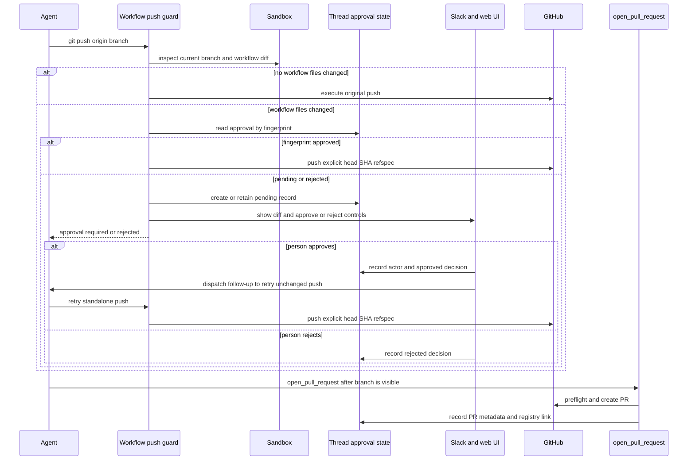

# Implementation and Pull Request Creation

The delivery path is **edit and commit in the sandbox → push the branch → open or update the pull request → hand off to review or CI monitoring**. Two controls protect this path: all new PRs must use the attributed `open_pull_request` tool, and a push carrying `.github/workflows/` changes must be approved by a person. The latter control is deliberately before PR creation: a PR cannot refer to a branch that the guarded push did not publish.

For sandbox creation, repository setup, and execution boundaries, see [Sandbox Lifecycle](../architecture/sandbox-lifecycle.md). For tool exposure and access policy, see [Tool Surfaces and Capability Gating](../concepts/tools.md); credentials and consent are covered in [Authentication and Security](../concepts/auth-and-security.md).

This sequence shows the guarded branch-publication and PR-creation path, including both human approval decisions.

## Prepare and publish the branch

The agent commits in its sandbox, then uses a conservative standalone push such as `git -C <repo> push -u origin <branch>`. `WorkflowPushGuardMiddleware` wraps both `execute` and `background_execute`, but only parses a narrow safe grammar: `git push origin <refspec>`, optionally using `git -C`, `cd … &&`, `--set-upstream`, or a safe `--force-with-lease`. It requires the refspec to publish the current branch to that same branch. Unsafe or unsupported standalone shapes are not interpreted by this guard.

A chained command is handled more strictly. If the middleware finds a push embedded in a longer command and sandbox inspection says it might carry pending or unpushed workflow edits, it blocks the whole command with `WorkflowPushMustStandAlone`. Commit first and issue the push separately, so the system can show the owner the actual workflow diff. A lease-protected push that cannot be safely inspected is also blocked rather than executed.

For an eligible push, the middleware inspects the sandbox repository. It compares the head with the remote branch when it exists, otherwise with the merge base against `origin/HEAD` (falling back to `origin/main`). A diff without paths below `.github/workflows/` is passed to the underlying execution tool unchanged. When workflow paths are present, the guard captures the binary diff, a bounded preview, changed-file and line statistics, base and head SHAs, normalized `origin` URL, and whether a merge merely inherited workflow changes from the base branch. A SHA-256 fingerprint covers this change identity, including the complete workflow diff and push ref details.

## Approve workflow changes

Approval state belongs to thread metadata under `workflow_push_approvals`, indexed by fingerprint. A record has `pending`, `approved`, or `rejected` status and retains the branch, SHAs, affected files, diff statistics and preview, inheritance hint, approval URL, notification state, and decision actor/time. Writes retain only the 20 newest records. Therefore changing any fingerprinted workflow content creates a new approval request; a prior decision cannot authorize a different workflow diff.

When the fingerprint is not approved, the push does not execute. The guard creates or refreshes a pending record and returns a structured `WorkflowPushApprovalRequired` tool error containing the fingerprint, file list, SHAs, stats, truncation indicator, and web approval URL. In a connected Slack thread it posts interactive approve/reject controls and a review link. It avoids repeated posts while the record is marked `notified`; that flag is set only after the Slack posting call completes.

An approved fingerprint causes the middleware to replace the agent's refspec with an explicit `<head_sha>:refs/heads/<branch>` refspec before invoking the executor. This binds the authorization to the inspected commit rather than whatever `HEAD` becomes later. A rejection remains blocked and reports status `rejected`.

The web API is mounted at `/dashboard/api/workflow-approval`. Listing requires an authenticated session and a readable thread. Approve and reject mutations additionally require same-origin protection and a promptable thread; both persist the session subject as the decision actor. Approval dispatches a follow-up instruction to retry the blocked standalone push without changing workflow files. Rejection only records the outcome. The same thread state can be reviewed through Slack controls or the web UI.

## Open the PR with `open_pull_request`

After the branch is published, create a new PR with `open_pull_request(owner, repo, head, base, title, body, draft=True)`, not `gh pr create` or a direct GitHub `POST /pulls`. The tool resolves a credential for the permitted PR author: it uses the selected thread participant's current GitHub OAuth token when an author login exists, otherwise it uses the GitHub App installation token for system threads. A missing user token raises the user-authentication requirement rather than silently changing the author. When a user token is used outside a private credential scope, the target repository must also be found in the workspace App installation.

Before creation, the tool may require act-as consent, then verifies repository access and the base branch. For same-owner heads it also checks that GitHub can see the pushed head branch. Its structured failures distinguish missing App or repository access (`github_app_access_missing_or_repo_not_found`), invisible branches (`github_pr_branch_not_visible`), unexpected preflight errors (`github_pr_preflight_failed`), and revoked user authorization. Diagnostic text includes GitHub's status, selected response headers, and a bounded response body, rather than hiding the remote cause.

On a successful GitHub `201`, the result returns `success=True`, `created=True`, URL, number, author, and token kind. A `422` create response triggers a lookup for an existing *open* PR with the same head branch. If found, the result is successful with `created=False`; update that PR with normal edit operations instead of creating a duplicate. Other failures return a non-success result with an explicit code. This idempotency is branch-scoped and does not imply that closed PRs are reused.

### Body, draft, and attribution details

The requested `draft` value is a default. A boolean `RunConfig.draft_prs` override takes precedence when the PR is created. The tool stamps an Open SWE collaboration footer containing the dashboard thread link and resolved model information.

Unless the caller already supplied `## References`, the tool can add a plan link and source context. Slack source references are allowed directly; Linear and GitHub issue references are added only when GitHub positively confirms that the target repository is private. This fail-closed distinction prevents source links from being copied to an unconfirmed public destination.

`PullRequestCreationGuardMiddleware` ensures an agent cannot hide an attributed-tool failure by creating a PR through the shell. It blocks `gh pr create`, `gh api` creation requests to a `/pulls` endpoint, and `curl` POST/body submissions to GitHub's pulls endpoint, including commands nested in supported `bash`, `dash`, `sh`, or `zsh` `-c` calls. Expansion is bounded; exceeding the nesting limit is blocked. The middleware returns a non-recoverable `PullRequestCreationFallbackBlocked` error with code `pr_creation_fallback_blocked`, while harmless operations such as `gh pr view`, `gh pr edit`, and comments remain usable. The main agent and its general-purpose subagent receive this guard; the workflow push guard is also installed for subagents.

## Record the delivered PR and its lifecycle

After creation or existing-PR discovery, telemetry is best effort: failure to record information does not revoke a PR already created on GitHub. The tool fetches PR details, records agent usage and opening feedback, upserts a normalized PR record in thread metadata, keeps legacy `pr_url` fields and `pr_urls` aligned, and saves a durable `PullRequest` registry link to the thread. A record includes repository, number, URL, title, normalized `draft`/`open`/`closed`/`merged` state, refs, author, creation time, diff statistics, and `resolves_thread`.

For an active Slack code-channel session, it additionally updates the repository context bar, registers the PR as an agent resource, and displays the GitHub diff only when it is nonempty. A PR can also be attached later using `link_pull_request(pr_url, resolves_thread=False)`, which validates the URL, checks accessible workspace scope, fetches GitHub details, and uses the same recording path.

Set `resolves_thread=True` only for a PR intended to finish the work. PR lifecycle webhooks update the linked thread records under a lock. A thread auto-resolves only when every tracked PR is `closed` or `merged` and at least one tracked record has that flag. If all are terminal without it, the thread receives `attention_reason="prs_closed"`; if a PR reopens, an auto-resolution and that attention mark are cleared as appropriate.

## Handoff after creation

`request_pr_review(pr_url)` is an explicit reviewer-agent handoff, not PR creation. It validates the GitHub PR URL, resolves active Slack thread context and triggering identity from run configuration, delegates to the GitHub review trigger, and adds a dashboard review URL when successful. For human-managed review and merge flows, see [Human and Expedited Review](human-review.md).

CI reads are best effort: `CommitChecks.read` concurrently reads GitHub check runs and legacy commit statuses and returns `None` if either cannot be read, for example because `Checks: Read` is unavailable. It filters Open SWE's own review and auto-fix checks so the system does not treat its work as third-party CI. The CI monitor recognizes only completed `check_run`, `check_suite`, `workflow_run`, or terminal legacy `status` payloads, extracts a branch and head SHA, and evaluates only active baby-sit watches for the same repository and SHA or branch. The watch evaluates the live PR/check state before deciding whether to wait, report a terminal problem, or dispatch a recovery run. See [Scheduling, Background Work, and CI Monitoring](scheduling-and-baby-sit.md).

GitHub feedback can wake further agent work. `fetch_pr_comments_since_last_tag` merges issue comments, inline review comments, and nonempty review bodies in chronological order. On a first configured Open SWE mention it retains all preceding context; on subsequent mentions it returns entries after the preceding mention. Mention matching rejects a configured handle when it is merely a prefix of a longer handle, and prompt formatting sanitizes reserved wrappers and fences comments from unregistered authors as untrusted.

## Focused verification

- `tests/github/test_open_pull_request.py` exercises credential scope, preflight access diagnostics, response handling, and recorded PR behavior.
- `tests/github/test_pr_creation_guard.py` covers direct and nested shell fallback detection, `execute` and `background_execute` blocking, and permitted safe commands.
- `tests/agent/test_workflow_push_guard.py` covers safe push parsing, diff fingerprints and inheritance, pending Slack approval, approved SHA-ref rewriting, unmodified pushes, and inspection failures.
- Thread visibility and authorization tests cover workflow-approval API access, while baby-sit tests cover CI webhook filtering and recovery dispatch.
