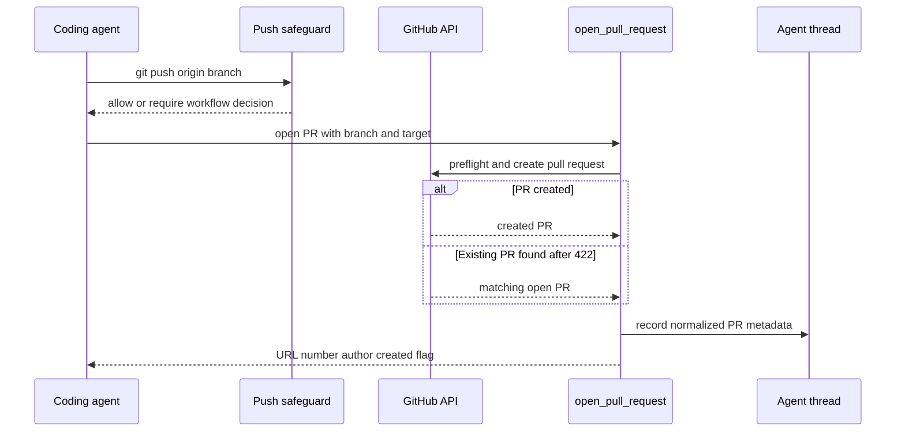
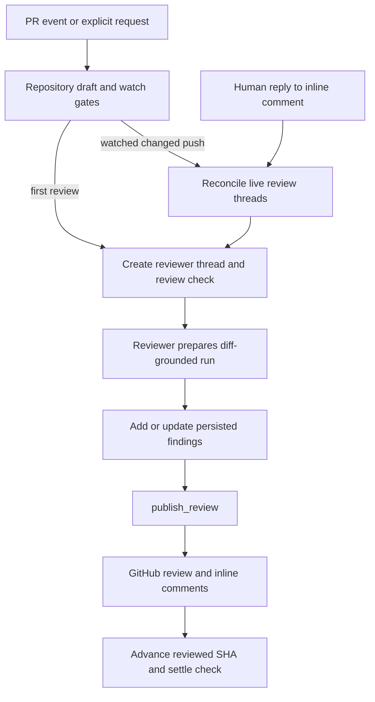

# Pull Request Delivery, Review, and Feedback Workflow

Open SWE connects an implementation run to a GitHub pull request (PR), then keeps the delivered change observable and reviewable. The main agent creates or links a PR; GitHub events can begin or continue a dedicated reviewer run; the reviewer persists findings and publishes a GitHub review; and later commits and replies reconcile that state rather than starting from scratch. A separate review-scout produces a human-facing walkthrough plan for a particular PR head.

<!-- openwiki: broken internal link [pr-review.md] file "pr-review.md" does not exist. Fix the href or restore the target, then delete this comment. -->
This page covers the handoffs and safety boundaries. For reviewer internals, see [Pull Request Review Workflow](pr-review.md); for invocation and follow-ups, see [Invocation Follow-ups](invocation-follow-ups.md); for the broader authorization model, see [Security and Authorization](../concepts/security-and-authorization.md).

## Delivery: create or attach the PR

The coding agent pushes its branch and calls `open_pull_request(owner, repo, head, base, title, body, draft=True, resolves_thread=False)`. This is the intended path for **new** PRs because it chooses an attributed GitHub credential: the requesting user's run grant when it belongs to that user, otherwise that user's stored OAuth token; system runs use the GitHub App installation token. The tool does not use a grant that belongs to another participant. Thus a user-triggered PR can be authored by that user, while a system-triggered one is authored by the bot.

Before creating the PR, the tool checks workspace installation membership when using a user credential and preflights access to the target repository, base, and head. It returns structured failures rather than masking GitHub errors. A `422` from the create endpoint gets a same-head open-PR lookup: if found, the tool returns the existing PR with `created: false`, records it, and the agent should update it rather than create a duplicate. The request body is augmented with references and attribution where applicable, and the runtime/profile draft policy can override the requested draft value for a newly created PR.

On successful creation or duplicate discovery, telemetry fetches current PR details, records agent usage, and upserts a normalized PR record into the originating thread's `pull_requests` metadata. The record carries repository, number, URL, refs, author, diff statistics, state, and the `resolves_thread` intent; legacy PR fields and `pr_urls` are maintained for older consumers. This is best-effort bookkeeping: a successful GitHub creation is still reported if telemetry fails.

Caption: PR delivery creates an attributed GitHub PR or returns an existing same-head PR, then records the delivery on the agent thread.

### Creation and push safeguards have limited scope

`PullRequestCreationGuardMiddleware` detects selected shell fallbacks for PR creation—including `gh pr create` and supported `gh api`/`curl` POST forms to GitHub pull endpoints—and blocks them so an attributed-tool failure is not silently replaced by an unattributed creation. It wraps tool calls and evaluates shell commands, not every possible GitHub mutation or every way a PR could be created.

`WorkflowPushGuardMiddleware` is a separate safeguard for pushes that would change `.github/workflows/`. It inspects supported push command forms and computes the workflow change before allowing the push. An approved change is pushed with an explicit immutable `head_sha:refs/heads/branch` refspec. For an inspectable workflow change without a matching approval, it blocks the push, persists the proposed change, and can request a decision. The guard also blocks workflow-changing standalone or chained push shapes it cannot safely inspect; ordinary pushes with no workflow change continue normally. It is a push-command safeguard, **not** a universal mediator for all repository writes or GitHub mutations.

The persisted `workflow_push_approvals` map is per agent thread and keyed by a fingerprint of the inspected change. A record includes repository, branch, base/head SHAs, changed files, statistics, bounded diff preview, notification state, and decision metadata. Pending records can be refreshed; approved and rejected records are terminal; retention is limited to the newest 20 records. Any changed fingerprint requires a new decision.

The dashboard exposes listing, approve, and reject routes beneath `/dashboard/api/workflow-approval`. They require a session and same-origin mutation protection; read access is required to list, while a promptable thread is required to decide. Approval records the session subject and dispatches a follow-up asking the agent to retry the unchanged push. Rejection leaves it blocked.

## Review entrypoints and durable state

A PR review uses the `reviewer` assistant and a canonical reviewer thread derived from the owner, repository, and PR number. `trigger_pr_review_from_ref` is the explicit entrypoint used by request surfaces: it fetches PR metadata, refuses drafts unless allowed, creates/updates the canonical thread, enables `watch`, posts a temporary review-started comment, and dispatches the reviewer with the base and head SHAs.

Webhook handling supplies automatic paths:

- `opened` and `ready_for_review` can trigger a first review, subject to enabled-repository and draft-author policy gates.
- A branch push (or fork synchronization) looks up an open PR, then re-reviews only if a canonical reviewer thread exists and is watching.
- Closing disables watch; reopening enables it. Converting to draft disables watch only when that author's effective draft-review setting is off.
- A non-bot reply to an Open SWE inline review comment is reconciled to its finding and dispatched as a focused `finding_reply` reviewer event.

A watched push is ignored if its head equals `last_reviewed_sha`. If the PR's effective diff is unchanged, the system advances that SHA and creates/completes a **No new changes to review** success check on the new head, because GitHub hides checks from the old head. For changed diffs, it first reconciles live review threads, updates metadata, creates a fresh in-progress review check, and runs a re-review from the prior reviewed SHA.

Caption: creation, re-review, and comment replies converge on the canonical reviewer state and publication path.

## Findings, publication, and feedback loop

The reviewer is restricted to review-oriented tools. `add_finding` validates severity, confidence, side, line range, and title; it obtains the changed-line set from prepared state/configuration or fetches the PR diff. An anchor outside the diff returns `in_diff: false` and explicitly tells the caller not to re-anchor or retry. A missing line endpoint is normalized to the other endpoint. Findings are attached to the reviewer thread with the current review head; duplicate open findings are handled by the finding store. Oversized suggestions are dropped while retaining the explanatory finding.

`publish_review` must be the only tool call in its turn and validates its ranking against the publishable finding set. It requires repository, PR, head SHA, and a usable GitHub token; eval runs are dry-runs. Publication uses the live review state to select eligible findings, creates a GitHub review and inline comments, persists GitHub identities, and settles the reviewer check. The live head is authoritative: a stale assessment is rejected without publishing or advancing the reviewed SHA. This prevents a report assessed for one commit being attached to another.

Later GitHub activity is reconciliation input, not merely notification. Before a changed-head re-review and upon a finding reply, Open SWE fetches live review threads and matches them to stored findings. A human reply records a `needs_reassessment` interaction and launches the reviewer with the finding identity and reply text. The reviewer can then clarify, resolve, or dismiss based on current evidence. New commits also withdraw Open SWE approvals made for superseded heads, so a previous bot approval does not remain valid after the change moves.

## Review scout: a separate walkthrough product

`ReviewScoutTarget` owns a different canonical thread and assistant, `review-scout`, for a PR/head-specific walkthrough. Starting a scout writes `kind: "review-scout"` and PR identity to that thread, reuses an active run for the same head, and interrupts/replaces work for an older head so only the current head's walkthrough is written.

The scout prepares a pinned checkout using read-only review permissions. It verifies that the PR still has the requested head before planning; a stale head, a moved plan, or an already-complete walkthrough ends as “nothing to plan,” rather than overwriting newer work. Preparation retries repository setup once, and the finishing middleware settles remaining unplanned changes into the walkthrough's “Other” area. Human steering history is included when present; without it, the human-input tool is hidden to avoid inventing a request context.

## CI, status, and human decisions

PR status is read from live GitHub data per tracked PR. The status loader returns an unavailable record when a tracked identity cannot be used, and the open-PR list deliberately reports `incomplete` instead of presenting an arbitrary partial GitHub search result. Dashboard consumers should treat unavailable/incomplete state as unknown, not as a clean PR. CI webhook processing can feed monitoring and automation; it is distinct from the reviewer check lifecycle.

Open SWE can request human review through `request_human_review`. The tool requires a canonical PR URL, an inline summary or supplementary-review text, and repository authorization. It creates or updates a human review card; a repeat request can reuse the existing card rather than post another. The result explicitly distinguishes auto-merge from the normal case where a person must merge. This is a handoff and coordination mechanism, not an authorization bypass.

Dashboard PR actions are also deliberate, typed mutations: merge requires an expected head SHA and a merge method, update-branch requires an expected head SHA, close confirms the changed state, and mark-ready verifies the PR is not closed before using GitHub GraphQL. Batch resolution of review threads only acts on thread IDs currently unresolved on that PR and is intentionally serial to avoid GitHub secondary-rate-limit pressure. These controls confirm the particular action's GitHub result; final merge/review policy remains GitHub and organizational policy territory.

## Operations and focused tests

To operate this workflow, configure GitHub App access for the relevant repositories and explicitly enable automatic review for repositories that should receive webhook-driven reviews. A missing App token, inaccessible repository/branch, stale head, or unavailable GitHub status should be investigated as a delivery/review failure rather than inferred from a successful agent message. For a blocked workflow push, inspect the thread's approval record and approve only the displayed fingerprint; then let the dispatched follow-up retry the unchanged command.

Representative tests cover the boundaries that are easy to regress:

- `tests/github/test_open_pull_request.py` exercises create-path token/preflight and duplicate behavior; `tests/github/test_pr_creation_guard.py` covers recognized shell fallbacks.
- `tests/github/test_pull_request_actions.py` covers confirmed dashboard mutation behavior; `tests/github/test_github_ci.py` covers CI normalization.
- `tests/reviewer/test_reviewer_watch.py`, `test_reviewer_reconcile.py`, `test_reviewer_findings.py`, and `test_reviewer_publish.py` cover watched heads, reconciliation, finding validation, stale-head publication protection, and publishing.
- `tests/reviewer/test_review_scout_launch.py` verifies scout identity is stored before run reuse/start and that planning context preserves relevant history.
- `tests/human_review/` covers human-review request, picking, posting, and supplementary-review behavior.
