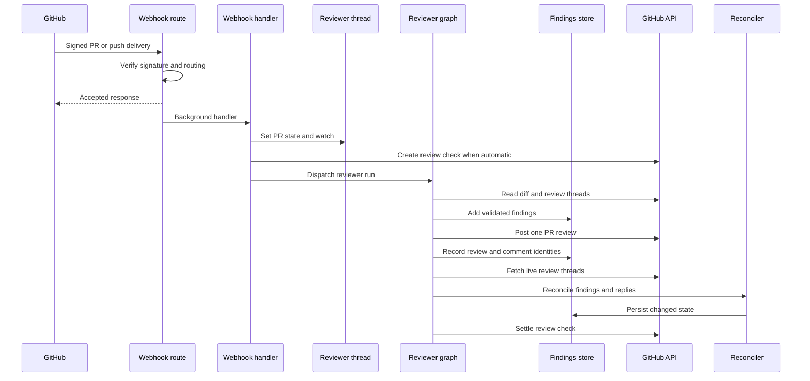

# Pull Request Review Lifecycle

Open SWE keeps one reviewer lifecycle per pull request (PR), rather than treating each webhook as an independent review. A canonical reviewer thread holds routing and run state; findings are durable PR records. Initial review, on-demand review, watched pushes, and replies to published findings all converge on that lifecycle. For the graph composition and the companion planning run, see [Reviewer and Review Scout](../architecture/reviewer-and-review-scout.md); for the tool contract, see [Tools](../concepts/tools.md).

## Admission and triggers

`POST /webhooks/github` is the signed ingress. It logs the delivery and invalidates the PR UI topic before deciding what to process. Invalid HMAC signatures receive `401`; malformed JSON and unsupported events/actions are acknowledged as ignored or error responses. When repository-to-workspace ownership cannot be read, it responds `503` so GitHub retries; an unowned repository is ignored. Accepted handlers run as FastAPI background tasks, keeping the delivery response separate from review execution.

Automatic first review accepts the `opened` and `ready_for_review` PR actions only when the repository has explicitly opted into review. The opt-in is stored on the repository record and fails closed: a database failure means no automatic review. Draft PRs additionally require the author’s effective `review_draft_prs` setting. Automatic push processing has the same opt-in gate.

An explicit automated review uses `request_pr_review`: it parses a GitHub PR URL, preserves an active Slack thread when available, and calls `trigger_pr_review_from_ref`. That entrypoint reads PR metadata, rejects draft PRs, derives the canonical reviewer thread, records PR/head/watch metadata, posts a transient **Open SWE Review: in progress** comment, and dispatches the `reviewer` assistant. Automatic first review follows the same thread and dispatch model, but creates an in-progress GitHub check instead of the transient status comment.

This sequence shows the webhook-triggered path through publication and the reconciliation pass that makes later feedback actionable.

## State ownership and preparation

`reviewer_thread_id(owner, repo, pr_number)` is a UUIDv5 derived from `"{owner}/{repo}/pr/{pr_number}/reviewer"`. Webhooks and other callers rederive this ID, so changing the formula would orphan live reviewer threads. LangGraph thread metadata stores the PR descriptor, live `head_sha`, `last_reviewed_sha`, `watch`, optional Slack origin, current run and check/status-comment identifiers. The `reviewer` assistant maps to `openswe.reviewer:traced_reviewer_agent`.

Findings are now stored in PostgreSQL under the pull request, linked to the reviewer thread by `pull_request_finding_state`; thread metadata remains the owner of thread-level routing state. The first access migrates legacy metadata findings into those rows. Benchmark/evaluation runs are deliberately different: they use per-run in-memory findings so repeated runs of the same PR do not contend on persistent PR state. Missing reviewer threads become a structured `thread_not_found` tool response with an explicit do-not-retry instruction.

Before the model runs, preparation mints and caches a repo-scoped GitHub App token, creates or replaces the per-thread sandbox, checks out the review revision, and materializes a first-review or re-review diff. It computes changed lines per file and side, which `add_finding` uses to validate anchors locally. Preparation also fetches live review threads and reconciles them; it can await a Review Scout walkthrough in parallel with checkout. The reviewer prompt receives PR descriptions and existing review-thread bodies as explicitly delimited, sanitized untrusted data, while organization guidance, repository style, base-branch instructions, approval policy, and trusted skills can refine the criteria.

## Finding creation and publication

A finding has a stable ID and fingerprint plus severity, confidence, location, lifecycle status, publication identity, and interactions. Persistence serializes mutations with a database row lock, writes only when a mutator reports change, and deduplicates an open finding by its fingerprint. Legacy publication fields are normalized on read to canonical comment/thread ID lists and forward-only surface state.

`add_finding` requires a generated non-default title; validates severity, confidence, side, and range ordering; and normalizes a one-ended range. Line-anchored findings must fall in the prepared diff line set. Out-of-diff anchors are rejected with `in_diff: false` and a do-not-retry message. A file-level finding has no inline anchor, and suggestions over four lines are dropped while keeping the descriptive finding.

`publish_review` first requires the reviewer to provide an exact, best-first ranking of eligible candidate IDs. It selects open findings at or above the requested threshold (default `medium`) and uses that rank before severity/file/line ordering. For a re-review, only unsurfaced findings first seen at the live head can be newly posted. It posts one GitHub PR Review, with inline comments anchored by path/line/side, a hidden finding marker for future matching, and optional fenced suggestions. The summary body carries a separate Open SWE marker.

The tool prefers the current `head_sha` from thread metadata over a run’s frozen configuration, which handles a push arriving while the run is active. After GitHub accepts a review, it records review, comment, and thread identity on the findings, advances `last_reviewed_sha`, links the review to the PR, clears any transient status comment, and settles the check. If GitHub rejects inline anchors with an identifiable `422`, it removes invalid candidates and retries the remaining batch once; otherwise it returns the affected IDs and remediation guidance rather than inviting identical retries. Eval mode is a dry run and stores a publication snapshot without posting to GitHub. An empty re-review after an existing Open SWE summary skips a duplicate summary but still resolves fixed threads and advances the reviewed SHA.

## Watch mode, reconciliation, and feedback

A close/reopen/draft transition changes only the existing reviewer thread’s watch flag: close disables it, reopen enables it, and conversion to draft disables it only when draft reviews are not enabled for that author. For a watched PR push, the handler ignores branch deletion, missing PRs, missing/non-watched reviewer threads, and a head equal to `last_reviewed_sha`. If the PR diff is provably unchanged, it advances `last_reviewed_sha` and creates then completes a fresh success check on the new head, because the previous head’s check is no longer visible. Otherwise it reconciles live review threads, updates metadata, creates a fresh check, and dispatches `re_review=True` with instructions to reconcile prior findings and add only net-new ones.

Reconciliation matches a finding to a live GitHub review thread by its embedded marker first, then its stored thread/comment identity. It backfills missing identities and marks findings surfaced. It records the latest human reply after the bot comment as an interaction requiring reassessment. A finding becomes `resolved` only when every matching thread is resolved; an outdated thread is terminal for synchronization but does not qualify as resolved. The sweep writes only if it changed data.

A `pull_request_review_comment` reply with a parent comment is routed before normal mention handling, but only from a registered Open SWE user and after the normal public-repository organization gate. The handler ignores bot replies, reconciles first, locates the parent finding, records the reply interaction, and dispatches a `reviewer_event="finding_reply"` run on the canonical reviewer thread. That run has the finding, sanitized reply, existing findings, and current review-thread context.

## Check settlement and operations

Automatic first reviews and watched re-reviews create an **Open SWE Review** GitHub check and retain its ID in thread metadata. Publication completes it with a conclusion based on surfaced findings. The ID is cleared only after a successful completion PATCH; a failed PATCH keeps the ID and stores the intended result for retry. The review graph’s after-agent middleware uses that pending result if present; if a run ended without publishing, it closes the still-open check as `neutral`, so infrastructure failure is not reported as a defect in the PR.

Enable repositories explicitly through the review-enabled repository setting; installing the GitHub App alone does not enable automatic comments. When a check remains in progress, inspect the reviewer thread’s `review_check_run_id` and `review_check_pending_result`, then verify token access and sandbox readiness. A `thread_not_found` tool result is terminal for that run rather than a signal to retry.

## Focused tests

`tests/reviewer/` covers automatic PR admission (`test_pr_ready_auto_review.py`), watch and unchanged-diff behavior (`test_reviewer_watch.py`), durable finding state and tool validation (`test_reviewer_findings.py`, `test_reviewer_tools.py`), reconciliation (`test_reviewer_reconcile.py`, `test_reconcile_sweep.py`), publication and error paths (`test_reviewer_publish.py`), and evaluation runs (`test_reviewer_eval_runs.py`). Start with [Testing Overview](../testing/overview.md) when choosing the repository test command; use [Human Review](human-review.md) for the separate human-review workflow.
