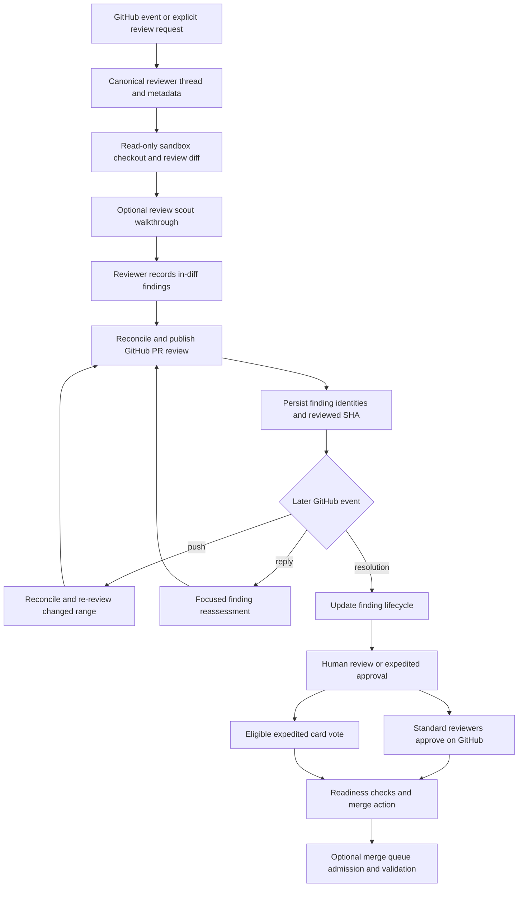

# Pull Request Review and Human Decision Workflows

Open SWE has complementary review paths rather than one generic approval mechanism. The **reviewer** agent produces durable, diff-anchored findings and publishes GitHub reviews. The **review scout** prepares a shared walkthrough of a PR. A **review guide** provides an interactive Slack code-review session. Human review requests use Slack cards and GitHub review state, while expedited review permits a deliberately small, fully visible change to receive a Slack-mediated approval before a guarded merge. The merge queue is a separate, policy-driven admission and validation system for configured repositories.

## End-to-end review and decision flow

This diagram shows that the reviewer retains responsibility for findings and GitHub publication, whereas human approval and merge decisions consume current PR state rather than trusting an earlier card or agent run.

## Automated and on-demand reviewer

GitHub webhook handling provides the integration boundary for PR events. `trigger_pr_review_from_ref` is the explicit-review entrypoint used when a PR reference is supplied: it obtains PR metadata and a repository-scoped GitHub App token, rejects a draft unless explicitly allowed, derives the canonical reviewer thread, creates it if necessary, stores PR/head/watch metadata, posts a transient started comment, and dispatches the `reviewer` assistant. It preserves Slack channel/thread information when the request originated there, so results can return to that conversation.

First reviews similarly use one canonical thread per owner/repository/PR. The webhook handler records the PR metadata, enables watching, creates an in-progress review check where possible, and dispatches a first review or—when a previously reviewed ready-for-review PR has moved—a re-review. If `ready_for_review` has the same head as `last_reviewed_sha`, it only refreshes the watch metadata and does not duplicate the review.

The reviewer is intentionally a **read-only review surface**. Its declared review tools include finding management, diff access, publication, thread replies/resolution, and selected read/search facilities; it explicitly omits commit, push, and PR-opening tools. This mutation boundary is important: a reviewer can report or reconcile a defect but cannot change the branch it is assessing.

### Deterministic preparation and diff scope

Before the model is called, reviewer middleware provisions a replaceable sandbox with read-only GitHub permissions and deterministically prepares the target repository. It derives the review range from `base_sha...head_sha` for an initial review—the merge-base view GitHub presents—or `last_reviewed_sha..head_sha` for a watched re-review. The resulting patch is materialized at a deterministic, hash-derived sandbox path and a per-file set of valid LEFT and RIGHT diff lines is passed to the run.

That range is both a relevance and a publication invariant. `add_finding` normalizes a one-ended range, validates severity, confidence, side, title, and ascending lines, and rejects an anchor that is outside the computed diff with a do-not-retry response. File-level findings can be recorded, but GitHub inline rendering requires a usable location. The tool stores the relevant diff hunk where available and drops, rather than truncating, a suggestion above the four-line limit. It also resolves the live review head from the durable thread before creating the finding and deduplicates equivalent open findings through the finding store.

The prompt also treats PR descriptions and existing review-thread content as untrusted data. It wraps that content in delimited data blocks, neutralizes closing tags, validates displayed author logins, and tells the model not to execute instructions embedded in those sources. Repository and organization guidance can be added alongside base-branch agent instructions and API standards guidance.

### Finding lifecycle, publication, and re-review

Findings are durable records on the reviewer thread, rather than ephemeral model prose. They carry location, side, severity, confidence, category, description, title, SHA/fingerprint, status, diff evidence, publication identities, and human interaction information. The store serializes updates per thread and writes only material changes; it exposes a specific missing-thread error as a terminal tool result rather than inviting the agent to recreate state blindly.

`publish_review` has a stricter contract than a normal comment tool:

- It must be the only tool call in its turn and its ranking must list every eligible candidate exactly once, in best-first order.
- It backfills and reconciles stored findings from live GitHub review threads before deciding what to publish, and resolves the current head from thread metadata rather than trusting stale run configuration.
- It considers only open, in-diff, unpublished findings at or above the requested severity threshold. A re-review additionally considers only findings first seen at the current head, preventing duplicate inline comments.
- It posts a single GitHub PR review containing hidden finding markers, inline comments where renderable, and a generated summary. Returned review/comment/thread identities are persisted so later reconciliation can find the corresponding GitHub thread.
- In evaluation mode it records the simulated publication without posting. An empty re-review after an existing Open SWE summary suppresses redundant “no issues” noise but still resolves fixed threads and advances `last_reviewed_sha`.

GitHub can reject a batch because an anchor has become invalid. On the identifiable unresolved-anchor response, publication fetches the live diff, removes only nonmatching candidates, and retries the remaining batch once; it returns the dropped IDs so the agent can resolve or repair those findings rather than repeatedly resubmitting an identical review. Authentication failures invalidate the cached thread token and require re-authentication.

Reconciliation makes findings evolve with the PR. It associates a live thread first by the embedded marker and then by stored IDs, backfills identities and surface state, recognizes the latest non-bot response after the bot comment, and resolves a finding only if all matched live threads are resolved. A later push can therefore re-enter the same review state instead of beginning a disconnected review. A reply can prompt a focused reassessment that replies for clarification or resolves/dismisses the finding. Reviewer checks and temporary started comments are settled or cleared along publication paths; the reviewer’s exit middleware uses a neutral outcome for an unfinished review rather than incorrectly presenting an infrastructure failure as a code failure.

## Review-scout support

The review scout is a separate `review-scout` assistant and thread per PR/head. It prepares a shared walkthrough: every changed line must end up in a described chunk or “Other,” and it can record a summary of human steering history. A new head supersedes older planning work; carried-forward plans cover already-known lines, and a fully covered plan finishes without a model call. The scout uses the same style of read-only sandbox checkout as the reviewer, then persists the settled walkthrough and invalidates PR UI data.

The reviewer can wait up to 600 seconds for a scout walkthrough. A timeout, unavailable database, missing SHAs, or scout failure does not block code review: the reviewer continues without the walkthrough, while a scout that finishes later still contributes to the review page. This makes the scout an enrichment path, not a prerequisite for correctness.

## Guided human review in Slack

A review guide opens a dedicated Slack code channel around an open PR. The requester must have a linked GitHub account and a valid token that can read the PR; the guide rejects inaccessible, closed, or non-open PRs. It classifies the session as author or reviewer, optionally forks the originating agent thread (including shared sandbox access), creates/binds the Slack channel and durable session, invites requested participants, adds repository and dashboard context, and dispatches a walkthrough turn.

Guide runs are system-originated and explicitly cannot approve the PR. When GitHub reports a PR update, open guide sessions receive a pause notice and progress refresh but no automatic run. Closed or archived-channel sessions remain closed; the reader’s own later message is what resumes work against the new head. This prevents a guide from silently continuing a stale review after the diff changes.

## Human review requests and standard merge decisions

`HumanReviewRequest` is the database state owner for Slack-driven decisions. It supports `standard`, `expedited`, and `posted` kinds with `open`, `merged`, `rejected`, `superseded`, or `cancelled` states. A partial unique index permits only one open request of any kind per PR, preventing concurrent standard and expedited decision paths. Participants are internal user IDs, with separate decisions for a Slack expedited vote, a standard-review signup, automated pick, or expiration.

A standard request first checks GitHub readiness: it refuses a closed/merged PR, draft, merge conflict, or required-check failure, and also requires the author to be an Open SWE user. It routes to an explicitly supplied or repository-configured review channel, persists the request and current head, posts a Slack card, and schedules assignment and (when enabled) auto-merge deadlines. An existing open request is reused rather than duplicated; an expedited request blocks a standard request until it is cancelled.

People sign up from the card to review on GitHub. After the workspace auto-assignment window, the scheduler can choose a reviewer or wake an agent if nobody qualifies. Standard auto-merge is conditional, not a blind card action: it waits for reviewer approvals and continuing PR readiness; the documented fallback allows auto-merge after two hours with at least one approval only when the request remains otherwise ready. A `posted` request instead tracks someone’s existing PR link, may receive an approved reaction and reviewer picking, but never merges the PR itself.

## Expedited approvals

Expedited review deliberately narrows what a Slack vote can mean. Eligibility requires a readable text diff, fewer than 100 changed files, complete accounting of all changed lines, and at most 25 shown non-test/non-generated lines (with a target of 20). Tests and generated files do not consume that shown-line budget; qualifying hunks may be omitted only with recorded `APPROVALS.md` rationale. CI workflows, migrations, dependency manifests, environment files, and authentication/credential/secret/token-related paths are never excludable. The request pins both the head SHA and a fingerprint of the reviewed diff, while the card renders the visible change and summarizes exclusions.

A draft expedited request initially goes only to the author as a readiness prompt. Only its author may mark it ready. A voter must be a linked Slack/GitHub person with repository write access, cannot be the author, and can vote once. Recording an approval immediately attempts to submit the voter’s GitHub approval on the matching fingerprint; if GitHub is temporarily unavailable, the recorded vote is retained and merge retries submission. Cards may be broadcast or copied only under the configured internal-channel constraints, protecting diff visibility.

An expedited merge is revalidated against live GitHub state. It requires an open, non-draft, conflict-free PR; no running, failing required, or unreported required checks; no unresolved review threads; no standing changes request; and at least one non-author approval. It rechecks the head while holding the request lock and uses GitHub’s merge result as final authority. A changed visible/excluded diff normally pauses merge without discarding the votes; an agent may explicitly retain them only with a recorded reason posted to GitHub. If the new diff is no longer eligible, the request is superseded and votes are discarded. A change limited to tests or generated files keeps the fingerprint and therefore the vote.

## Merge queue: a distinct production gate

The merge queue is not the expedited merge path. A configured controller registers a queue for its configured workspace/repository `main` branch, verifies the repository identity and a pinned validation-workflow digest, and schedules a minute-by-minute runtime job. Its admission reader requires that the PR targets and originates in the configured repository/branch, remains open at the requested head, is approved and not draft, and has successful configured GitHub Checks from trusted app/workflow sources—not legacy commit statuses.

Admission also ensures required workflow files did not change between merge base and PR head, validates workflow-run provenance, and for configured review-artifact checks verifies that approval evidence is bound to the exact repository, PR, head, and base after the latest review change. It rereads its inputs before accepting admission to detect concurrent changes. These checks make the queue an extension point for trusted policy and staged validation, rather than a bypass for review or GitHub protections.

## Operational guidance and focused tests

Operate reviewer behavior through durable thread metadata and GitHub state: a missing token, failed sandbox preparation, unavailable GitHub API, or absent reviewer thread should be investigated as infrastructure/state failure rather than retried by inventing new findings. Preserve the reviewer’s no-mutation tool boundary when adding tools. Changes to line validation, finding IDs/markers, or review-thread reconciliation need compatibility review because they affect durable state and GitHub comments.

Focused tests cover the review lifecycle in `tests/reviewer/`: PR-ready automatic dispatch, watched re-reviews, diff parsing/materialization, finding validation, publishing and its retry cases, reconciliation sweeps, outcomes, API/session behavior, and scout launch. `tests/human_review/` exercises standard requests, posting, and reviewer picking; `tests/expedited_review/` covers eligibility, readiness, voting, card rendering/diff images, and merge behavior. These suites are the appropriate regression boundary for changes that alter a decision gate or notification lifecycle.
