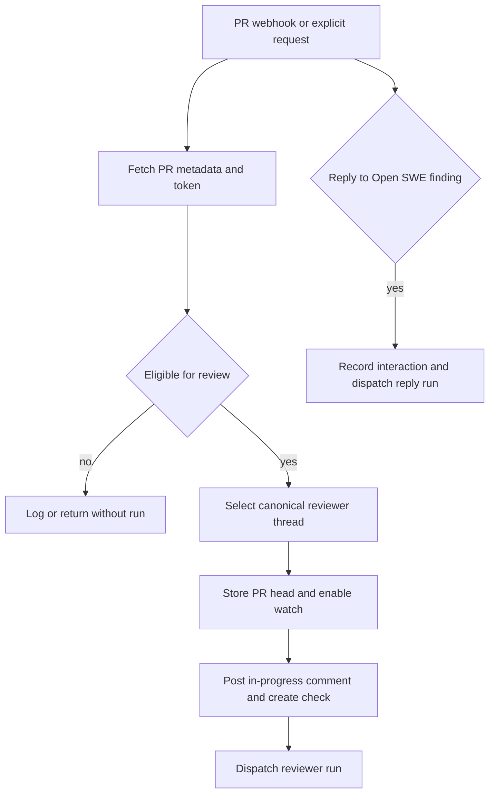
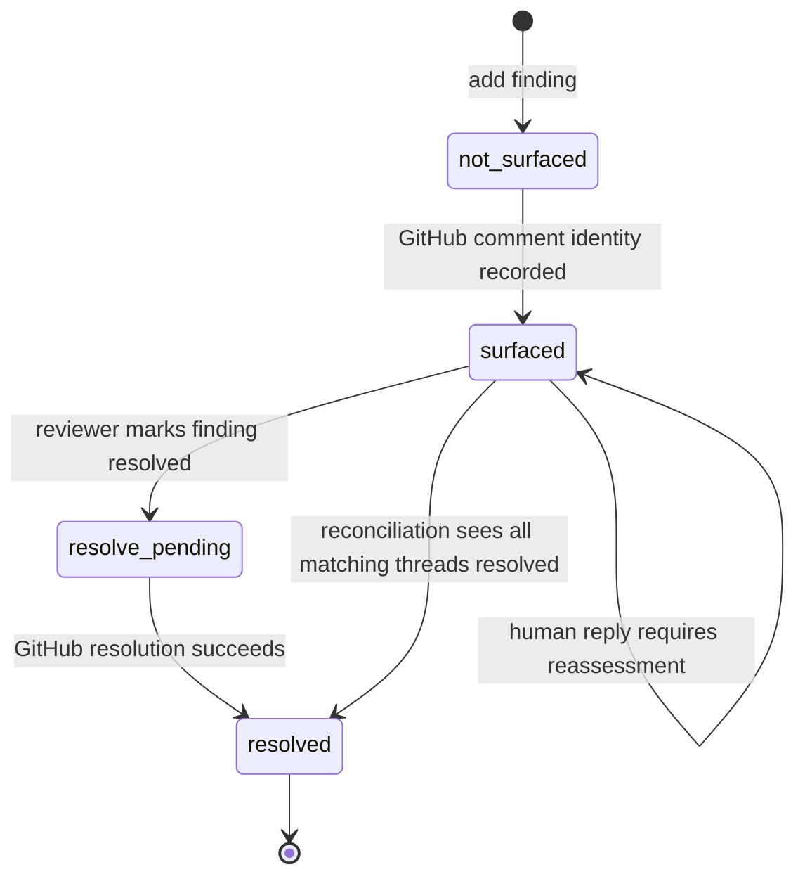
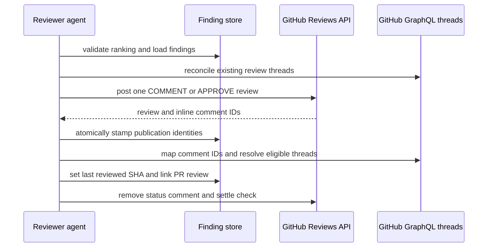
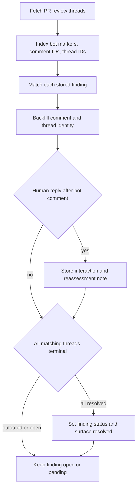

# Pull-request review and findings workflow

Open SWE runs pull-request review as a dedicated, read-oriented reviewer workflow. A canonical reviewer thread represents one repository PR across initial review, later pushes, and replies to review comments. The thread holds operational metadata such as the PR identity, current head SHA, watch flag, check/status-comment identifiers, and `last_reviewed_sha`; durable findings themselves are PR-scoped PostgreSQL records.

This workflow is separate from normal coding-agent conversation. The reviewer can inspect a checkout, record findings, publish/comment/resolve GitHub review threads, and make a governed approval decision, but it has no commit, push, or PR-opening tools. See [Reviewer and review-scout architecture](../architecture/reviewer-and-review-scout.md) for graph and sandbox details, and [GitHub, Slack, and Linear integrations](../integrations/github-slack-and-linear.md) for webhook admission.

## Entry points and eligibility

A review can start through an explicit PR reference (for example, a Slack review request) or automatically from GitHub PR activity.

- **Explicit request:** `trigger_pr_review_from_ref` fetches PR metadata using an App token, rejects drafts, then re-scopes the token for the target repository. It creates or advances the canonical reviewer thread, records PR metadata, `watch=True`, and the head SHA, posts an in-progress status comment, and dispatches the `reviewer` assistant. A Slack-origin request can retain its Slack thread reference for the completion reply.
- **First automatic review:** `opened` and `ready_for_review` dispatch paths require PR number, URL, base SHA, and head SHA. Drafts are reviewed only when the PR author’s effective `review_draft_prs` setting permits it. A `ready_for_review` event with the same `last_reviewed_sha` updates metadata but does not dispatch another run.
- **Push or fork-head update:** automatic review must be enabled for the repository; the PR must already have a reviewer thread with `watch=True`, be open, be draft-eligible, and have a new head. A direct push looks up the open PR for the pushed branch. A `pull_request.synchronize` event is used for fork heads in the upstream PR context.
- **Finding reply:** a human reply to an Open SWE inline review comment is matched by its parent comment ID to a stored finding. The webhook appends a `human_reply` interaction, reconciles thread state first, and launches a successor reviewer run with `reviewer_event="finding_reply"` and the reply context. Bot replies are ignored.

Close/reopen/draft transitions alter watch behavior: closing disables watch, reopening enables it, and converting to draft disables it only when draft review is not enabled for the author. A later push also withdraws any Open SWE approval of an earlier commit; failure to do so is logged rather than preventing later background work.

This diagram shows the admission boundary: later activity only enters the reviewer after PR, token, thread, and watch eligibility checks.

## Prepare a bounded review

Before the first model call, `PrepareReviewerRunMiddleware` obtains a repository-scoped App token, creates or replaces the reviewer sandbox if necessary, and deterministically prepares a checkout at the review head. The GitHub proxy has `READ_ONLY_REVIEW_PERMISSIONS`; a reviewer sandbox may be replaced because the checkout is re-derived each run. If replacement still cannot reach a sandbox, Open SWE posts an inability-to-review notification rather than silently leaving the PR pending.

Preparation concurrently collects the checkout, diff, PR overview, GitHub review threads, repository and workspace guidance, and—when applicable—the review-scout walkthrough. It makes the following boundary important:

| Run kind | Review range | Publication expectation |
| --- | --- | --- |
| First review | PR base/head comparison using merge-base semantics | Assess the PR and create findings |
| Re-review after new commits | `last_reviewed_sha..head_sha` | Reconcile old findings and publish only net-new findings at the new head |
| Reply follow-up | Reply/finding context | Reassess the addressed finding and reply or resolve as appropriate |

The prepared diff produces `diff_text` and a per-file, per-side changed-line set. Existing GitHub review threads are fetched and reconciled before they become reviewer context. PR titles, descriptions, and review-thread bodies are untrusted author-controlled input: the reviewer wraps them in data blocks, validates displayed logins, neutralizes closing tags, and truncates long existing comments. Failure to retrieve those threads degrades to a review without thread-awareness rather than aborting the run.

If a push changes only the commit SHA but not the PR diff, the webhook normally avoids an agent run: it links the review to the new SHA, advances `last_reviewed_sha`, carries the walkthrough forward when PostgreSQL is available, and completes a success check titled “No new changes to review.” The exception is approval mode `approve` with an available policy, because approval eligibility must be reconsidered.

## Finding lifecycle and storage

A finding has a stable ID and fingerprint; severity (`low` through `critical`), confidence, category, normalized title and description; path, range, and side; first-seen and last-confirmed SHAs; status; optional suggestion/hunk; rank; publication identities; and imported thread interactions. Findings are stored under the PR in PostgreSQL, while callers address them through the reviewer thread. Legacy findings in thread metadata are copied on first access. Each mutation locks and reads the latest PR finding state so a stale agent snapshot does not overwrite a concurrent update.

`add_finding` is the creation gate. It requires a nonempty generated title, validates severity, confidence, side, and ordered line range, normalizes a single supplied endpoint into a one-line range, and resolves the live thread head rather than trusting a possibly stale run configuration. It accepts an anchor only if the range is in the current diff on the requested `LEFT` or `RIGHT` side. Out-of-diff anchors return a structured **do-not-retry** error; the tool may fetch the PR diff when prepared state is unavailable. Suggestions longer than four lines are dropped while retaining the finding description.

A missing reviewer thread is also a structured do-not-retry condition: retrying cannot recreate an evicted or never-created thread. Evaluation runs deliberately use run-scoped in-memory findings and simulate publication, avoiding cross-run contention on production PR state.

This diagram is the monotonic internal surface lifecycle. `status` and GitHub’s current thread state are synchronized by reconciliation rather than assumed to change together.

## Publish one review safely

The reviewer ends a review by calling `publish_review`. It must be the only tool call in its model turn. The supplied `ranking` must list every expected publication candidate exactly once, most important first; unknown, duplicate, or missing IDs return an error before either rank persistence or GitHub publication.

This diagram shows publication ownership: GitHub accepts the review first, then the finding store records the exact review/comment/thread identities needed for later reconciliation.

Publication filters to open, in-diff findings at or above the requested severity threshold, and only emits an inline payload when it has a file and line anchor. Each inline body contains a hidden marker with the finding ID and location; suggestions are rendered as GitHub `suggestion` blocks. Findings below the threshold remain stored and are counted as additional hidden findings rather than posted. On a re-review, an already-published finding is never reposted, and a new inline finding must have been first seen at the current head.

The review summary includes a hidden PR marker used to detect prior Open SWE reviews. If no new inline findings or assessment exist and a prior review is known, publication suppresses a duplicate “no issues” review while still resolving fixed threads, advancing the reviewed SHA, clearing the live status comment, and completing the check. The prior-review lookup is deliberately tri-state: an API failure is unknown, not evidence that no previous review exists.

GitHub can reject an otherwise prepared review because an inline anchor no longer resolves. On a 422 anchor error, the publisher recomputes the current diff, drops only known-invalid anchors, and retries the batch once when valid comments remain. If it cannot identify valid anchors, it returns a structural error with IDs for the agent to fix or resolve instead of blindly retrying the same payload. A 401 invalidates the cached token and instructs the requester to reauthenticate.

After GitHub accepts a review, Open SWE fetches its inline comments and maps them to findings exclusively through the embedded marker. It stamps the GitHub review ID and comment IDs in one findings write, then discovers GraphQL thread IDs. This preserves enough identity for reply and resolve actions even if a subsequent run has no in-memory publication snapshot. A successful publish links the PR to the reviewer thread and head, deletes the transient status comment, settles the review check, records usage, and sends the initial Slack completion reply when the review began from Slack.

## Reconciliation and resolution

GitHub is the current authority for whether a review thread is open, resolved, outdated, and replied to; the internal finding remains the durable record of what Open SWE raised. Reconciliation fetches PR review threads through GraphQL and matches a finding in this order: its marker on an Open SWE bot comment, known GraphQL thread ID, then known REST comment ID. Markers on a human comment are ignored.

This diagram shows why reconciliation does not treat a single outdated thread as proof that a finding is resolved: all matched threads must be resolved to reach the resolved state.

For each matching bot comment, reconciliation backfills identities and marks the finding surfaced. A human reply after the bot comment is truncated for storage, retained as a `human_reply` interaction with `needs_reassessment=True`, and recorded as the latest reply. A finding becomes internally resolved only if **all** matching threads are resolved. Outdated threads are terminal for matching purposes but do not alone prove resolution.

When the reviewer has resolved a surfaced finding, publishing can post its supplied resolution note as a reply and calls GraphQL `resolveReviewThread`; GitHub exposes this mutation at the thread level, not through the REST review-comment endpoint. Resolution failures leave state available for a later retry instead of claiming success.

## Approval policy and post-review behavior

An optional assessment is a separate advisory judgment for the exact reviewed SHA: risk score, `would_approve` or `needs_human_review`, and explanation. An assessment that claims approval while any finding remains open is changed to `needs_human_review`. The publisher refuses an assessment whose SHA differs from the live review head.

Criteria come from `.open-swe/APPROVALS.md`, read from the repository’s default branch and capped at 15,000 characters. Reading policy from the default branch prevents the PR under review from rewriting the policy and applies one policy across target branches. The repository approval mode controls the effect:

| Mode | Behavior |
| --- | --- |
| `off` | Do not load/use approval criteria or publish an assessment-driven approval |
| `dry_run` (including lookup failure fallback) | Publish the assessment as commentary only; no approval or merge |
| `approve` | Publish `APPROVE` only for an open, non-draft PR whose current head matches the reviewed SHA |

The mode is reread at publish time, so an administrator disabling approval or switching to dry-run during a review wins. GitHub self-approval rejection falls back to a comment review. Open SWE never merges the PR. Each publication withdraws earlier Open SWE approvals unless it is keeping the new current-head approval; new commits also trigger withdrawal of approvals for superseded commits.

## Operations and focused tests

For reliable review operation, GitHub App access must be available for the repository: missing token, unreadable PR metadata, missing base/head SHA, or inability to create the reviewer thread prevents dispatch. PostgreSQL is required for durable production findings; the workflow can migrate old thread-metadata findings on access, while evaluation is explicitly in-memory. Watch-driven re-review begins only after an initial reviewer thread exists, so an operator can initiate it through a Slack `@open-swe review <url>` request or by requesting `open-swe[bot]` as a GitHub reviewer.

Focused tests under `tests/reviewer/` cover the meaningful boundaries: automatic PR-ready eligibility (`test_pr_ready_auto_review.py`), watch/changed-diff behavior (`test_reviewer_watch.py`), finding validation and persistence (`test_reviewer_tools.py`, `test_reviewer_findings.py`), publication ranking/anchor/approval behavior (`test_reviewer_publish.py`, `test_approvals.py`), and marker/reply/all-thread reconciliation (`test_reviewer_reconcile.py`, `test_reconcile_sweep.py`). Changes to reviewer triggers should also preserve GitHub route handling and the canonical-thread behavior tested with review conversation/session coverage.
