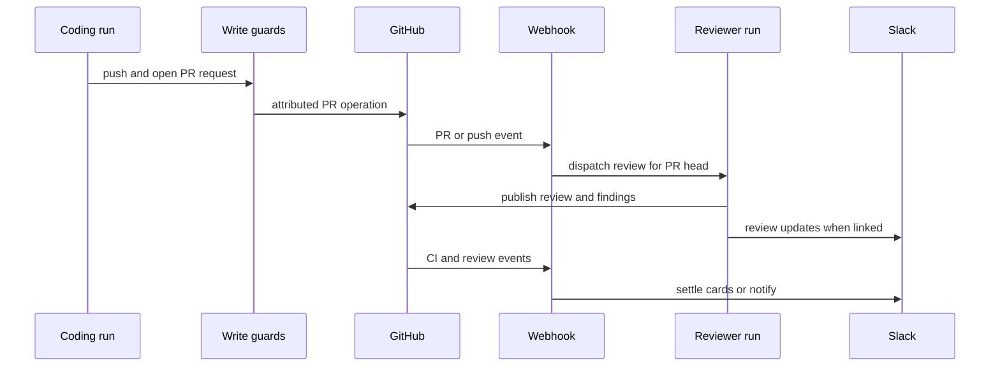

# Pull request work, review, and delivery

Open SWE treats implementation, review, and delivery as distinct kinds of work. A normal coding run can modify a sandbox and propose a PR; a **reviewer** run is a read-only review specialist that prepares a PR checkout and diff, maintains findings, and publishes a GitHub review. A **review scout** is separate again: it creates an implementation walkthrough for a particular PR head, rather than findings or code changes. This separation is intentional: the reviewer tool set excludes commit, push, and PR-opening tools, while the scout is a durable `review-scout` run keyed to the PR and head SHA.

This shows the delivery loop and its independent coding, review, and event-processing roles.

## Guarded implementation writes

### Create a PR through the attributed tool

The coding path must use `open_pull_request`, not an ad hoc shell/API fallback. The middleware detects `gh pr create`, GitHub `/pulls` POSTs through `gh api` or `curl`, and nested shell commands, then blocks them with an instruction to surface the tool failure. This preserves the attribution and credential rules implemented by the tool: it resolves the requested/requesting user's OAuth grant only when it is demonstrably that user's grant, otherwise falls back to that user's stored sign-in; system threads use the GitHub App installation token. The tool reports preflight and branch-visibility failure context rather than silently claiming that a PR was created.

This is the first approval/identity boundary: creating or mutating a PR uses GitHub credentials with the intended actor's permissions. PR actions such as merge, close, mark ready, and update branch are also explicit, typed actions. They confirm GitHub's response before reporting success; a non-success response, invalid response, or a missing expected result becomes an HTTP error. In particular, marking ready uses GraphQL because the REST API cannot clear GitHub's draft flag.

### Stop workflow changes before a push

A separate `WorkflowPushGuardMiddleware` inspects standalone `git push` commands for `.github/workflows` changes. It computes a change fingerprint and stores a pending approval record with repository, branch, base/head SHAs, affected files, statistics, and an optional diff preview in thread metadata. Until that exact fingerprint is approved, it blocks the push; the message directs the owner to approve in Slack or the web UI. It can post a Slack approval card for an active Slack thread, or propagate the request to a related thread. Rejected or uninspectable/unsupported workflow pushes do not fall through to execution. Approval records are advisory-lock protected, terminal decisions are not replaced, and the bounded record list is retained in thread metadata.

Thus an approval is required **before** the Git push that would alter a workflow—not merely before merge. An approval applies to the inspected fingerprint, so a changed diff must be inspected and approved again.

## Review and scout runs

### Entrypoints and lifecycle

GitHub webhook routing handles PR, push, CI, review-thread, and submitted/dismissed-review events asynchronously. For repository opt-in auto-review, qualifying PR events dispatch an initial reviewer run; push events re-evaluate watched reviewer threads. A manual GitHub/Slack review request validates that the repository is allowed, reads PR metadata and base/head SHA, rejects drafts unless draft review was explicitly allowed, creates or succeeds the canonical reviewer thread, persists PR/watch/Slack context, posts a review-started comment, and dispatches the `reviewer` assistant.

The initial dispatch creates an in-progress Open SWE check run on the current head when possible. When a PR is marked ready with a new head, or a watched head changes, the run is a re-review: it is instructed to reconcile existing findings and add only net-new findings. Repeating the same `last_reviewed_sha` is skipped. If the changed PR diff is identical to the previously reviewed diff, Open SWE records the review linkage and completes a current-head check as “No new changes to review” rather than spending a new model run.

A reviewer prepares its own sandbox and deterministic checkout, materializes the relevant diff range, computes permitted changed file/line locations, and obtains PR metadata and existing review threads. PR titles and bodies are author-controlled data and are escaped into a data block for the reviewer prompt. The resulting agent is constrained to review tools—finding creation/update/listing, publishing, discussion/reply and resolution utilities—not coding delivery tools. Findings must be anchored to the reviewed diff before publication rather than discovered to be invalid only at GitHub write time.

A review scout instead creates an implementation walkthrough for an open PR head when walkthrough support is enabled. Its canonical thread follows succession, an active pending/running scout for the same head is joined, and a newer head succeeds the old thread so only the latest head can write a walkthrough. Scouts are repository-allowlist checked and dispatched with `assistant_id="review-scout"`, source `review-scout`, PR identity, SHAs, and workspace; they do not publish a code review or alter the PR.

### Findings are local state reconciled with GitHub

The reviewer evolves a single set of findings. `publish_review` selects eligible open findings at or above the requested severity threshold and batches them into one GitHub PR review: a summary/assessment plus inline comments anchored to file, line/range, and diff side. Every generated comment carries a hidden marker tying it to the local finding; optional suggestions are rendered as GitHub `suggestion` blocks. Returned GitHub comment identities are stored on the findings.

On re-review and webhook processing, reconciliation reads current GitHub review-thread state and maps threads back by stored thread/comment identity or marker. If all linked threads are resolved, an open finding becomes resolved; reopening a resolved GitHub thread reopens it. Human replies are recorded on the finding as needing reassessment. Failure to read or persist reconciliation intentionally preserves the existing readable finding snapshot instead of erasing it. When a finding moves from open to resolved, publication can reply with the resolution note and resolve the GitHub review thread through GraphQL.

GitHub review-thread resolution/unresolution and replies route back to the reviewer context. Submitted GitHub reviews also produce a deduplicated Slack notification where a linked Slack context exists, so GitHub remains the review authority while Slack is a collaboration surface.

## Human review and expedited approval

`request_human_review` is an agent/MCP boundary that first checks the caller's repository access and requires a short summary (unless requesting a supplementary review). Standard review refuses PRs that are closed, merged, draft, or otherwise blocked; for a draft it can offer the author an author-only Slack “Mark ready” path. For a ready PR, the system records a single active standard request for that PR, captures its head SHA and fingerprinted context, schedules assignment/auto-merge deadlines, posts a Slack review card, links it back on GitHub, and can point the originating Slack conversation to the card. If card posting or deadline scheduling fails, it discards the incomplete request rather than leaving an unserviceable review open.

Expedited review is deliberately narrower. Its eligibility logic requires reviewers to see a readable, bounded production diff (target 20 and accepted maximum 25 changed lines); test files are excluded from those size/visibility gates because CI evaluates them. Sensitive categories—including `.github`, migrations, dependency manifests/locks, environment files, and credential-like paths—cannot be hidden by auto-approve rules. An approved-with-condition automated assessment can substitute the condition for the diff.

On an expedited card, only the PR author can mark a draft ready, and only a non-author whose GitHub identity has repository write access can approve. A vote is stored under a row lock, refreshes the Slack card, and is submitted as that person's GitHub approval immediately when the current diff fingerprint still matches. A delivery failure leaves the vote recorded for submission during merge; a changed head prevents submission. The first approval wakes the associated agent to merge, rather than the Slack click directly merging the PR. The card cannot be copied out of a shared/external channel, and only eligible internal public channels may receive a copied expedited diff.

## CI follow-up with baby-sit

`manage_baby_sit` starts an opt-in durable watch only for an open, readable PR with a head SHA/ref and a GitHub App installation. The watch is stored in the PR's `task_state["baby_sit"]`, joins the task coordinator, retains run/source context for later wakeups, and has both webhook-first evaluation and a ten-minute polling schedule. A different task cannot stop its watch or record its retry.

CI handling reads both check runs and legacy commit statuses. It excludes Open SWE's own review and auto-fix checks from fixable third-party CI, treats only `failure`, `timed_out`, and `action_required` check-run conclusions as auto-fix candidates, and does best-effort reads so missing Checks permission or transient GitHub errors do not break webhook handling. Completed CI webhooks are deduplicated by delivery ID and serialized with a per-watch lock; polling uses the same evaluation logic.

For a head, pending checks remain watched. Success additionally waits until every required check for the base branch has reported; then the owning agent is woken once per green head and the watch remains active for later commits. Terminal non-success/non-rerunnable states require owner triage and stop the watch. Fixable failures wake the owning coding thread with names, conclusions, and URLs, once per head/retry fingerprint. A new head resets retry and dispatch state. The agent may record a flaky rerun only with evidence; retries are limited to three per head, with deduplicated GitHub/Slack-source alerts. Repeated inability to evaluate CI or resume the agent eventually stops the watch with a diagnostic—never merges the PR.

## Operational reading of PR health

Dashboard PR health is a live GitHub-derived view, not a merge permission decision owned by Open SWE. It surfaces current head/ref, draft/mergeability, review decision and reviewers, unresolved review threads, check state, and failing/pending/missing checks. Reviewer state follows GitHub semantics: a later comment does not erase an earlier approval or changes-requested decision, and any changes-requested verdict dominates. Required checks combine classic branch protection with supported rulesets and can pin a check to the reporting GitHub App; unsupported required workflow/code-scanning rules can cause a caller that demands mappable rules to fail closed.

For changes to this workflow, preserve the boundaries: coding agents perform guarded writes; reviewers and scouts work on distinct canonical threads and do not become coding agents; GitHub confirms mutations and remains the source for PR/review/CI state; Slack cards, notices, and buttons coordinate people but do not bypass GitHub identity, head/fingerprint, repository-access, or pre-push approval checks.

## Focused verification

Useful targeted tests are organized around these contracts:

- `tests/github/test_pr_creation_guard.py` and `tests/github/test_open_pull_request.py` cover the attributed PR path and blocked bypasses.
- `tests/reviewer/test_pr_ready_auto_review.py`, `tests/reviewer/test_reviewer.py`, `tests/reviewer/test_reviewer_publish.py`, and `tests/reviewer/test_reviewer_reconcile.py` cover reviewer dispatch, diff/finding publication, and GitHub thread reconciliation.
- `tests/reviewer/test_review_scout_launch.py` covers durable scout start/join behavior.
- `tests/github/test_baby_sit_webhook.py` and `tests/github/test_github_ci.py` cover CI event handling and check interpretation.
- `tests/github/test_pull_request_actions.py` and `tests/github/test_review_slack_notifications.py` cover confirmed PR mutations and GitHub-to-Slack review feedback.
