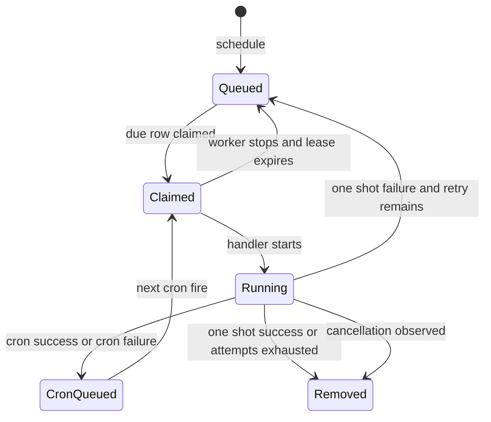
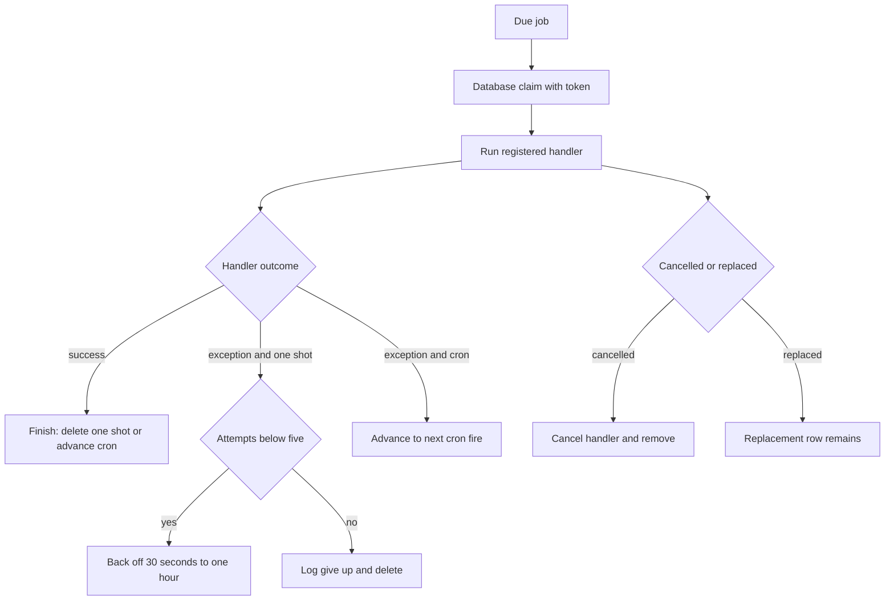
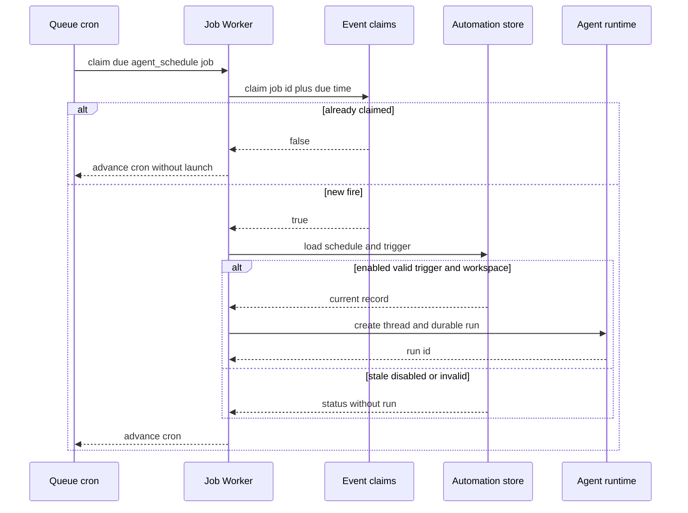
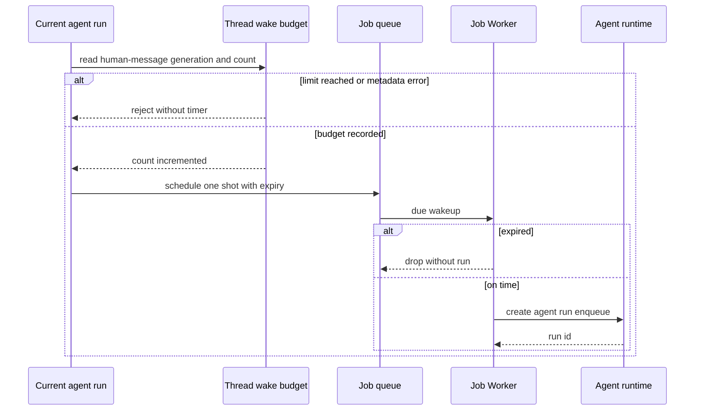

# Schedules, watches, and background recovery

Open SWE uses a PostgreSQL-backed job queue for work that is due once or on a cron expression. This keeps timer and background work independent of an Agent Server graph: a job has a `kind`, JSON payload, due time, optional cron/timezone, replacement `key`, and metadata; a registered handler performs the actual action. The FastAPI lifespan starts the worker after database migration and stops it during shutdown.

The queue is the execution substrate, not the source of business intent. Agent automations are stored as automation and trigger records; baby-sit watches are stored with their pull request; background commands are recorded in the owning thread and sandbox; workspace refresh state is stored with the workspace. Queue jobs invoke those durable owners and re-check current state, so cancelled, edited, or obsolete work does not become authoritative merely because an old timer fires.

## Job queue lifecycle and delivery semantics

`queue.schedule()` persists a one-shot job or cron job. A non-null `key` is an upsert key: scheduling again replaces the previous row, clears its lease and attempts, and updates payload and timing. This is used for one active watch, poller, or daily refresh per logical owner. Jobs may also be located or cancelled by metadata.

Every application replica may poll, but `claim_due()` selects due, unlocked rows with `FOR UPDATE SKIP LOCKED`, assigns a random claim token, and leases each claim for 30 minutes. The worker runs at most 20 jobs in flight, polls more rapidly after it starts work, and renews a running claim every 10 seconds. A cancelled job causes the handler to be cancelled on the next renewal; a replaced job is allowed to finish without overwriting the replacement. On clean worker shutdown, in-flight handlers are cancelled and their rows become claimable after the lease expires.

This diagram shows the queue's claim, completion, retry, cron, and lease-recovery lifecycle.

Handler exceptions drive queue retry behavior. A one-shot job retries at most five total attempts with exponential delays from 30 seconds, capped at one hour, then is removed and logged as given up. A cron job does **not** retry a failed occurrence: it advances to the next cron fire. Missing handlers follow the same failure path. Many handlers that work with sandboxes are additionally wrapped in transient sandbox-attach retries; after those retries are exhausted for a recognized transient error, the wrapper logs and returns rather than causing a queue retry.

This diagram shows the distinction between queue retries for one-shot failures and skipped failed cron occurrences.

### Registration and startup migration

Importing `openswe.jobs.kinds` registers the handlers on the shared `WORKER`; the application imports it before starting the worker. `start_jobs()` runs first, independently protects each startup step, migrates legacy Agent Server crons and thread records, and ensures the one-minute `thread_status_reconcile` cron exists.

The cron migration scans non-thread-bound legacy Agent Server crons under a short-lived distributed claim. It recreates supported baby-sit, background-task, workspace-refresh, and agent-automation timers as queue jobs, updates the owning record through each adopter, and then deletes the old cron. If adoption fails, it leaves the old cron in place for the next startup. Thread-bound legacy crons are intentionally skipped because they are wakeups with their own cleanup path.

## Persisted agent automations

The dashboard exposes list, create, update, manual trigger, and delete endpoints at `/schedules`; mutations require an admin session and are audit-wrapped. A schedule has a prompt, explicit workspace, model/effort selection, enabled state, and one or more typed triggers. Cron triggers accept only normalized five-field cron expressions; event triggers can be GitHub repository events, Slack-channel messages with sender/regex/rate filters, or Linear team issue events. Only schedule triggers create queue cron jobs; event triggers are launched by their relevant webhook/event paths.

Creation validates the workspace, the configuring user's GitHub access where applicable, and Slack-channel visibility. An `admin_thread` schedule is admin-only, and it is refused for GitHub events in a public repository because public issue or PR text is untrusted while an admin thread carries workspace-admin tools. Creating the queue crons precedes database insertion, but failures roll back the newly created cron jobs; update similarly rebuilds triggers when needed and cleans up old timers. Deletion cancels all associated jobs before deleting the automation record.

Each enabled cron trigger gets a keyed `agent_schedule` job carrying both `schedule_id` and `trigger_id`. On fire, the handler constructs a fire identity from the queue job id and its `due_at`, then takes a two-day event claim before launching. This prevents a job reclaimed after a crash or deployment from launching the same scheduled occurrence twice. The launcher reloads the automation, verifies that the named schedule trigger still exists, cleans up orphan jobs when possible, and then creates a fresh agent thread and durable agent run. The run is explicitly marked as automation input with `source: "schedule"`, a schedule-specific system sender, the selected workspace/environment, and a new invocation ID. A disabled schedule, deleted workspace, or unavailable repository produces a status/error result rather than running with a different workspace or unauthorized repository.

This diagram shows duplicate-fire suppression and the state revalidation that makes timer delivery safe across edits and recovery.

## Thread wakeups

The `schedule_thread_wakeup` tool schedules a one-shot `thread_wakeup` queue job for the *current* thread. It accepts whole-minute delays from 1 minute through 24 hours, rounds the requested time up to a UTC minute, and preserves relevant run context such as repository, source, Slack thread, identity, and schedule ID. It places a system input message and run configuration in the payload, identifies the job metadata as `thread_wakeup`, and gives it an expiry 90 seconds after the intended fire time.

Wakeups are constrained by the per-thread `THREAD_WAKEUPS` budget: no more than 10 self-started wakeup runs between human messages. The budget generation is the latest human message key; system wakeups do not reset it. An in-process per-thread lock serializes read, record, and schedule in one process, and the count is persisted in thread metadata before the job is created. If budget inspection or recording fails, no wakeup is scheduled. A new human message makes the stored generation stale and starts the count at zero.

At fire time, `run_thread_wakeup()` drops an expired payload rather than starting a late run. Otherwise it calls `runs.create` for the `agent` assistant with `multitask_strategy="enqueue"` and the completion webhook, so the wakeup waits behind any active run in the same thread. The worker catches and logs wakeup errors instead of retrying: a server-side run might have started even if the client observed an error, and retrying could duplicate it. `cancel_thread_wakeups()` removes matching queue jobs and legacy Agent Server wakeup crons, while opportunistic cleanup deletes only expired legacy wakeup cron rows.

This diagram shows budget accounting, expiry protection, and serialized follow-up delivery to the owning thread.

## Baby-sit CI watches

`/baby-sit` watches are durable, opt-in PR CI monitors. Their state lives under `task_state["baby_sit"]` on the pull request and includes the current head, retry count, dispatch/delivery/alert deduplication keys, evaluation-error count, configuration, source context, and the thread to wake. Starting a watch joins the initiating thread to a task and uses the task coordinator as the target thread. A PR already watched by another task is rejected. It schedules one keyed `baby_sit` queue cron every 10 minutes; stopping removes that job and then removes the persisted watch state (or marks it inactive if job deletion fails).

Polls and CI webhooks both evaluate a watch, but a five-minute event claim lock on the watch key ensures only one evaluator proceeds. A webhook additionally records bounded delivery IDs before evaluating, preventing repeated webhook delivery from redoing work. Evaluation ends a closed PR's watch, refreshes the head SHA and resets retry/deduplication state when it changes, reads CI and required checks, and categorizes the result as pending, success, blocked, or failure.

* **Pending** keeps the watch running. A nominal success remains pending until every required check has reported.
* **Success** dispatches a green-check prompt to the coordinator thread and stops the watch.
* **Blocked** (terminal but neither successful nor rerunnable failure) produces a terminal owner-triage handoff and stops the watch.
* **Failure** uses a fingerprint of head SHA and retry count to dispatch at most one repair prompt until the agent records another retry. Dispatch failure removes that fingerprint so a later evaluation can retry the handoff.
* The owning agent may record at most three flaky reruns per head SHA. New commits reset that budget. Alerts for the same check are deduplicated, and only the watching task may record retries.

Unavailable tokens, pull data, head data, required checks, or CI status increment an evaluation-error count. The first two such failures leave the watch for later evaluation; the third emits a terminal notice and stops it. Terminal notices normally try the originating Slack/GitHub location, but when that is inappropriate or fails, the system enqueues a run on the owning coordinator thread. It also uses the agent thread rather than posting into a Slack thread it owns. Thus CI outcomes return to the thread that has the task context rather than being interpreted by the scheduler itself.

## Background sandbox commands and notification handoff

Background command completion can arrive through the sandbox-tools callback path or through a per-thread one-minute `background_tasks` polling cron. Callback-capable launches track the task before launching it, so an immediately completed command cannot be missed; the completion route authenticates tool access and checks that the reported task belongs to the supplied sandbox and either its owner thread or permitted host thread. Callback listing failures deliberately remain server errors so the runner retries. Users without callbacks get a keyed, per-thread poller that is cancelled after the thread has neither running tasks nor undelivered terminal tasks.

Reconciliation reads the owning thread's metadata and sandbox task listing, filters tasks by ownership (with a compatibility rule for legacy tasks), updates the tracked running IDs when the set changes, and syncs Slack background status. For each terminal, undelivered task, it atomically creates a `notify.claim` directory in the sandbox. The winner builds a system completion message and dispatches it with `multitask_strategy="enqueue"` to the owning thread. Only after dispatch succeeds does it rename the claim to `notify.done`; any exception removes the claim, allowing callback or polling to deliver it later. A sandbox monitor lock prevents a poller from deciding it is idle and cancelling itself while a command launch is in progress.

The dashboard only connects to a thread's sandbox when thread metadata says a command or monitor is active, avoiding an idle-thread view that would wake a stopped sandbox. It exposes running commands/monitors and, when monitors exist, the monitor budget consumed in the current human-message window.

## Refreshes and recovery sweeps

Each workspace may have a keyed daily `workspace_refresh` cron, deterministically staggered between 03:00 and 05:59 UTC. It can also be started as a one-shot background job; callers get the job ID and obtain status/output through the task interface rather than waiting for a rebuild inline. The handler distinguishes full versus update refreshes and can sweep all scripted workspaces when no slug is supplied. A refresh marked `refreshing` for three hours is treated as stale so a lost worker cannot block a later attempt forever; builder sandboxes are stopped after capture rather than deleted directly.

Two reconciliation mechanisms recover thread availability. The startup-installed `thread_status_reconcile` cron runs each minute and asks the runtime about indexed threads that have stayed busy for more than one minute, updating statuses that completion webhooks failed to settle. Separately, the registered `reconcile` handler can run `reconcile_stale_runs()`: it pages through busy threads, finds pending runs older than its default 30-minute limit, interrupts them in bulk, and continues past per-thread errors. This second sweep exists because a lost completion webhook can otherwise leave both a pending run and its thread busy forever.

## Operations and extension guidance

* Treat job handlers as at-least-once delivery boundaries. Persist the business-side deduplication/ownership state before an external dispatch, and make repeated delivery safe. The agent-schedule fire claim, baby-sit watch lock/fingerprints, and sandbox notification claim/done markers are examples of separate protections for different failure windows.
* Use a stable `key` for “one active timer per owner”; do not use it when each one-shot must be retained. Ensure a replacement handler cannot mutate state as though it still owned the key.
* For a new job kind, register it from `openswe.jobs.kinds` before worker startup; validate the minimal payload at the handler boundary; choose whether exceptions should invoke queue retry; and, for sandbox work, decide whether the transient sandbox retry wrapper is appropriate.
* Do not rely on a cron job to retry a failed occurrence: cron failures advance to the next tick. If a specific fire needs deduplication or recovery, persist a fire key/claim in the domain owner.
* Monitor logs for repeated `Job failed`, `Job gave up after repeated failures`, lease-renewal failures, wakeup failures, and baby-sit evaluation errors. The queue itself has no dead-letter store; exhausted one-shots are removed after logging.

## Focused test coverage

`tests/agent/test_baby_sit.py` verifies that failure dispatches are deduplicated until a retry is recorded, concurrent evaluations dispatch only once, a green webhook wakes the agent and removes the watch, terminal notification falls back to the originating agent thread, retry and alert budgets are bounded/reset by a new head, and unrelated tasks cannot take over a watch. `tests/tools/test_schedule_thread_wakeup.py` verifies delay bounds and minute rounding, context propagation, human-message budget reset versus system-message non-reset, parallel scheduling at the shared budget, cancellation scoping, expiry cleanup, and that expired queued wakeups never start a run.
