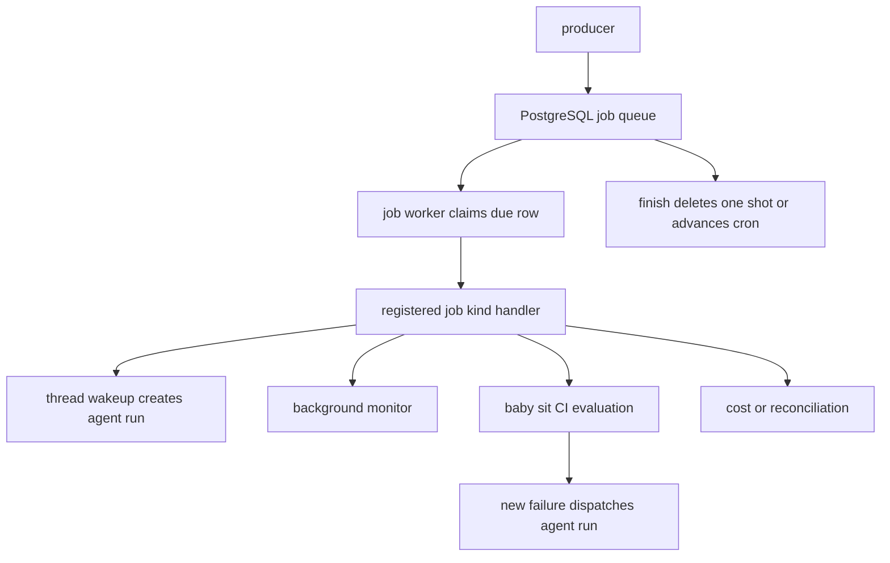
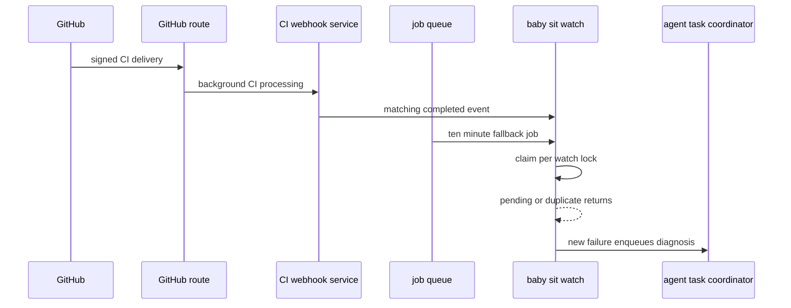

# Scheduling, Monitoring, and Baby-Sit

Open SWE's model-free automation plane is a PostgreSQL-backed job queue, not a `scheduler` LangGraph assistant. Producers enqueue a typed job with a JSON payload; the in-process worker claims due rows and invokes the handler registered for that kind. A job can be one-shot (`due_at`) or recurring (`cron` plus timezone), and a `key` makes scheduling replacement/idempotence explicit. Agent runs are a *result* of a few handlers, rather than the execution mechanism for every scheduled tick.

This page covers the lifecycle and safety boundaries of this automation layer. For agent/thread ownership see [Threads and state](../concepts/threads-and-state.md); for normal user follow-ups see [Follow-up messages](follow-up-messages.md); for PR creation see [PR creation](pr-creation.md).

## Queue and worker lifecycle

`queue.schedule()` validates a cron expression, computes its next UTC fire time when necessary, and upserts by `key`. This lets a producer maintain exactly one logical recurring job such as `baby_sit:<watch-key>` or `background_tasks:<thread-id>`. One-shot jobs are deleted after successful execution; cron jobs are advanced to their next fire and reset their attempt count.

The worker claims at most 20 due jobs at a time. Claims have a 30-minute lease and are renewed every ten seconds while work runs; a cancelled job causes the handler task to be cancelled. An unhandled handler error backs off a one-shot job from 30 seconds exponentially up to one hour and gives up after five attempts. A failing cron is instead advanced to its next scheduled fire. Consequently, handlers must be safe to repeat: a lease can lapse during shutdown and a later worker can claim the row again.

Diagram: producers create durable work, while the worker dispatches the kind-specific bounded operation and then settles or reschedules the row.

The worker's registered kinds include `agent_schedule`, `baby_sit`, `background_tasks`, `session_cost`, `agent_cost`, `reconcile`, and `thread_wakeup`. Most sandbox-touching handlers use a transient-sandbox retry wrapper. The `thread_wakeup` handler is deliberately different: it logs and suppresses a creation error rather than retrying, because an ambiguous SDK failure might already have created the agent run and retrying could duplicate the wakeup.

## Recurring automations and reconciliation

Dashboard automations are stored in PostgreSQL as automation records and triggers. Each enabled schedule trigger owns one `agent_schedule` cron job; cron text is normalized to exactly five fields and each numeric, list, range, or step component is range-checked before storage. A fired `agent_schedule` job carries the automation and trigger IDs. Before launch, the worker claims a `job-id:due-at` fire key for two days, avoiding a second launch if a reclaimed execution repeats after a crash or deployment.

`launch_scheduled_agent_run()` rereads the stored automation, verifies that the named trigger is still a schedule trigger, and launches the configured automation. It treats removed records and mismatched/replaced triggers as non-launching outcomes and removes old orphan jobs when it encounters them. Creation/update failure cleanup also deletes jobs already created, while deletion failures are recovered when an obsolete job later fires.

Completion webhooks normally settle durable agent dispatch. `reconcile_stale_runs()` is the safety net when that signal is lost: it paginates busy threads, lists each thread's pending runs, and interrupts those older than 1,800 seconds by default. It skips bad timestamps and catches errors per thread, returning counts for checked threads, stale runs, and cancellations. A bad thread or page therefore cannot block the rest of the recovery sweep.

## Delayed cost enrichment

Cost information can lag a completed run. Both refresh paths use independent one-shot jobs and the fixed delays `(15, 30, 60, 120, 240)` seconds rather than a permanent poller.

- **Session cost:** successful completion schedules an initial `session_cost` job only when the run has a valid invocation and Slack thread/message context; metadata prevents the same completed run from scheduling it twice. The handler confirms the Slack mapping and message, reads both cumulative and run-only LangSmith costs, and updates the Slack footer. A transient unavailable trace or Slack update schedules the next attempt. Invalid prerequisites, a definitive unavailable result, a successful update, or exhaustion ends the chain; unavailable/exhausted paths clear the pending-cost label where possible.
- **Agent usage cost:** an `agent_cost` job obtains a run-only LangSmith cost and writes it to the invocation usage record, then best-effort mirrors it to thread metadata under a per-invocation key. A LangSmith-unavailable error ends immediately; other missing/failing retrieval or persistence advances through the same bounded delay budget and eventually returns `exhausted`.

## Background command monitoring

Long-running sandbox commands have two completion sources: an opted-in runner callback or a per-thread `background_tasks` job every minute. `ensure_background_task_polling(thread_id)` schedules the latter under a stable key. Both flows reconcile only commands owned by the relevant thread; legacy unowned commands belong to the sandbox host thread.

For every terminal command not already marked done, reconciliation atomically creates a sandbox `notify.claim` directory before enqueuing a system-context completion message to the agent thread. It moves the claim to `notify.done` only after dispatch succeeds; a failure removes the claim, allowing a later callback/tick to deliver once rather than lose the completion. The prompt names status, exit code, duration, and output path, leaving the agent to retrieve output as needed.

The monitor also updates tracked task state and Slack background status. When it observes no running command and no undelivered terminal notification, it takes a sandbox monitor lock, rereads tasks, and only then cancels the polling job. Missing thread or sandbox metadata likewise stops polling. That second read prevents a race from deleting monitoring as a task finishes or appears.

## Thread wakeups

`schedule_thread_wakeup` lets an agent request a delayed re-entry of its current thread. It accepts 1–1,440 minutes, rounds the due time up to a minute, and queues a one-shot `thread_wakeup` job with an expiry about 90 seconds after firing. The payload contains a system-identity input with the supplied prompt or the default polling prompt, selected repository/source context, and prepared run metadata. When it runs before expiry, `run_thread_wakeup()` creates an `agent` run with `multitask_strategy="enqueue"`; an expired job is dropped.

Wakeups are limited to ten per latest human input-message generation. The tool derives a generation hash from the newest human `<input-message>`, stores that generation and count in thread metadata under a per-thread asyncio lock, and resets the count only when a new human message appears. System-originated messages, including the wakeup itself, do not reset it. The count is recorded before the job is scheduled, so an unsuccessful schedule still spends a slot and cannot create a retry storm.

`cancel_thread_wakeups()` removes queue jobs matching its wakeup metadata and also deletes legacy Agent Server cron wakeups for the thread. `scripts/purge_wakeup_crons.py` remains a migration/backfill utility for expired legacy cron rows: use `uv run python scripts/purge_wakeup_crons.py --dry-run` to inspect candidates, then run without `--dry-run` to delete them. It resolves the URL from `--url` or `LANGGRAPH_URL`, and credentials from `LANGGRAPH_API_KEY` or `LANGSMITH_API_KEY`.

## `/baby-sit`: durable CI monitoring

`/baby-sit` is an opt-in PR CI recovery workflow. The durable watch is stored in the PR's `task_state["baby_sit"]`, keyed by normalized `owner/repo#number`, rather than in a standalone watch store. Starting a watch associates the initiating thread with a task and then uses its task coordinator as the dispatch thread; membership, not simple thread equality, decides whether another caller owns the watch. A different task cannot start an active watch for the same PR. Restarting on the same head retains retry, delivery, dispatch, and alert deduplication state; a changed head resets those fields.

Each watch uses a keyed `baby_sit` job on `*/10 * * * *` as its fallback. Job creation failure rolls back a genuinely new PR state; stopping cancels the keyed job and removes state, or marks state inactive when cancellation fails so it cannot evaluate. The fallback does no model work while CI is pending or while it sees an already-dispatched failure.

Diagram: signed CI events provide prompt evaluation while the queue job is the ten-minute fallback; both serialize on the same watch lock.

The GitHub route rejects an invalid `X-Hub-Signature-256` before parsing the payload, then sends supported CI events to background processing. `handle_ci_webhook()` considers only completed CI payloads, finds active watches whose SHA or head branch matches, and retains a bounded list of delivery IDs per watch. It skips a repeated delivery, updates the installation ID when supplied, and evaluates under the same five-minute `event_claims` lock used by scheduled evaluation. Concurrent triggers therefore return `busy` rather than dispatching the same failure twice.

Evaluation fetches the PR and its third-party check runs and commit statuses; Open SWE's own checks are excluded. It stops an inactive, missing, closed, or merged watch. A head change resets retry and failure/alert dedupe state. Incomplete or empty checks are `pending`; completed `failure`, `timed_out`, and `action_required` checks (or failure/error statuses) are failures; other non-success terminal outcomes are blocked; success requires completed successful/neutral/skipped checks and all branch-required checks to be reported. Unlike earlier polling designs, success is handed back immediately after that required-check validation—there is no fixed settle interval.

A failure is deduplicated by head SHA plus retry count. For a new fingerprint, the service records the key before enqueueing an agent run on the coordinator thread; dispatch failure removes that key so a later event can retry. The generated prompt identifies the PR, head, retry budget, and failure signals, which should be treated as untrusted inputs. The agent may call `record_retry` only after evidence supports a flaky rerun. That operation verifies task membership and head SHA, caps retries at three per head, and posts a flaky alert at most once for a head/check/safe GitHub URL.

Terminal blocked checks, retry exhaustion, and three consecutive evaluation errors call `_finish_watch`. It first attempts an appropriate source notification except where a Slack-owning agent or expedited review requires the agent fallback; it then enqueues a terminal `/baby-sit` run if notification was not delivered and stops the watch. A clean ready result similarly enqueues the ready prompt for the coordinator and stops the watch; if that dispatch fails, it falls back to the terminal notification path.

## Operations and focused tests

The job worker starts only when the database is configured. Startup imports legacy Agent Server crons and threads, then ensures the standing thread-status reconciliation cron; individual producers create their own durable recurring jobs. Operators should investigate repeated `Job failed`, `Job gave up after repeated failures`, sandbox claim/delivery failures, and reconciliation counts rather than adding unbounded retries.

Focused coverage is in `tests/agent/test_baby_sit.py`, `tests/github/test_baby_sit_webhook.py`, `tests/tools/test_manage_baby_sit.py`, `tests/tools/test_schedule_thread_wakeup.py`, `tests/reviewer/test_reconcile_sweep.py`, `tests/agent/test_session_cost.py`, and `tests/agent/test_agent_cost.py`. These exercise CI deduplication and ownership, signed routing, wakeup limits and expiry, stale-run isolation, and bounded refresh behavior.
