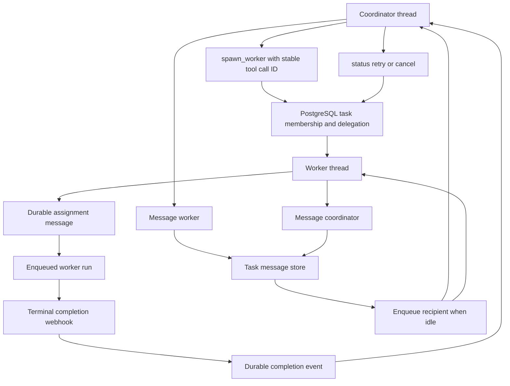

# Task and Worker Coordination

Task coordination is an opt-in, durable delegation protocol for one **coordinator** thread and its **worker** threads. It is not LangGraph's in-graph `task` subagent mechanism: a worker is an independently addressable, user-owned thread with its own runs and conversation state. PostgreSQL stores the task relationship, delegation record, and messages; LangGraph runs the threads. This lets a coordinator continue, inspect, message, retry, or cancel work after processes and individual runs end.

A task has exactly one permanent coordinator and a workspace. The first `spawn_worker` creates the task and coordinator membership; later spawns add worker memberships and delegations to that same task. A worker cannot create siblings or descendants: it can communicate only with its coordinator. The agent receives role and task context through `TaskCoordinationMiddleware`, while the tool set exposes `spawn_worker` only to an eligible coordinator and exposes status, messaging, and worker control to task members.

See [Threads, Persistence, and Run State](../concepts/threads-and-state.md) for the runtime/thread boundary, [Workspaces, Repository Routing, and Access](../concepts/workspaces-and-access.md) for workspace and credential scope, and [Follow-Ups, Interrupts, and Completion Replies](follow-up-messages.md) for the durable-run delivery model.

## Membership, roles, and authorization

`Task`, `TaskMembership`, and `TaskDelegation` are the authoritative PostgreSQL records:

- `Task` records the title, workspace foreign key, permanent `coordinator_thread_id`, and whether work was delegated. A task, all memberships, delegations, and task messages cascade away when its workspace is deleted.
- A `TaskMembership` maps one thread ID to a task and role: `coordinator` or `worker`. Per-coordinator advisory locking makes concurrent first delegations converge on one task.
- A `TaskDelegation`, keyed by worker thread ID, binds a worker to its task and coordinator and retains the assignment instructions, selected model/effort, launch error, and cancellation flag. Repeating the same delegation preserves the existing record rather than creating another worker.

Authorization is deliberately stricter than thread visibility. Before task operations, `authorized_metadata` requires an authenticated actor, a GitHub login gate, a user-owned thread belonging to that same Open SWE user, and normal readable/postable access. It resolves and persists `owner_user_id` when legacy metadata has only a login, so an account rename does not transfer task authority to a new account claiming the former login. Task context also checks that the thread still has the task workspace.

The coordinator is additionally checked against both membership role and `Task.coordinator_thread_id`. `owned_worker` verifies the target delegation, membership, task, coordinator, and workspace before a coordinator can inspect, retry, or cancel it. A worker may send a message only upward to the permanent coordinator; a coordinator must name an explicit member worker. This prevents cross-task messaging and control even if a caller knows another thread ID.

Coordination is controlled by the task owner's `experimental_task_coordination` preference. Delegation also requires a configured completion webhook, a sandbox attached to the coordinator, and a supported sandbox bridge: one-shot CLI bridges are rejected because their bridge closes before asynchronous workers can finish. Sandbox guests cannot delegate further. A cancelled worker is rejected when its middleware is built, preventing a late run from doing more task work.

This flow shows durable membership, bidirectional coordinator/worker events, and the worker lifecycle; all task messages go through the persistent message store before a recipient run is requested.

## Spawning a worker and inheriting its execution context

`spawn_worker` requires nonblank instructions and a stable injected tool-call ID. It derives a deterministic UUIDv5 worker ID from coordinator thread ID plus that request ID. Thus a replay of the same tool call reserves and launches the same worker rather than duplicating delegation. Under the coordinator lock, `Task.reserve_worker` either creates the coordinator's task or validates its existing coordinator role and workspace, then records worker membership and delegation before launch. This reservation-first design leaves an inspectable, retryable worker if thread creation or dispatch fails.

`launch_worker` creates the LangGraph thread through the common `create_thread` entrypoint with `if_exists="do_nothing"`, then verifies that persisted identity-critical metadata still agrees with the reservation. It records the assignment as `initial:{worker_id}` and asks the durable queue to enqueue it. The worker title is the first 80 characters of the instructions; all openable threads still require a title.

The worker deliberately inherits only execution-relevant coordinator metadata, not the coordinator's integration conversation context. It copies user identity and visibility, admin status, repository selection, branch metadata, sandbox and sandbox-proxy data, GitHub token repository narrowing, and participant lists. It stamps the task workspace, task ID, coordinator as `sandbox_host_thread_id`, and task origin/category/trigger metadata. In particular, worker runs share the coordinator-hosted sandbox rather than receiving a separate sandbox identity. A worker can reconnect to a replacement host sandbox, but cannot create a replacement if that host was deleted; the coordinator must recover it.

Model selection is resolved in the task workspace. An explicit `model`/`effort` request is validated against models enabled there. Without an override, the coordinator's usable selected model and effort are inherited; unsupported inherited choices fall back to that workspace's agent defaults. The resolved selection is persisted on the delegation and stamped explicitly in worker metadata, so retries do not drift with subsequent coordinator or workspace changes.

## Task events and delivery semantics

Both assignments and messages are `TaskMessage` rows. Each row contains the task and recipient thread IDs, content, recipient run configuration, optional structured `TaskEventMetadata`, a deterministic UUID derived from `(task, recipient, delivery_id)`, delivery attempts, and delivery/checkpoint timestamps. The `(thread_id, delivery_id)` conflict rule makes a sender retry idempotent. Delivered rows are retained for seven days; uncheckpointed work is not removed by that cleanup.

`record_event` recalculates recipient configuration, verifies that recipient membership belongs to the task and that its workspace still matches, and refuses cancelled workers. It then serializes a message or completion event. Display metadata identifies the task, sender thread and role, optional safe title label, kind, content, and—only for a completion—the terminal status. The actual content is converted to structured input messages with task-event metadata and an `event-match:{id}` message ID, keeping worker-originated text in its untrusted-message boundary rather than letting it alter instructions.

`TaskMessage.deliver` is the wakeup side, not the source of truth. It uses a per-recipient PostgreSQL advisory lock, rechecks cancellation, and—for `"enqueue"`—does nothing while the thread is busy. It compares durable rows to event-match IDs checkpointed in the thread state, marks recognized rows delivered, and submits all owed messages in order in one durable `agent` run with `multitask_strategy="enqueue"` and `if_not_exists="reject"`. A recipient gets at most three dispatch attempts for a given owed batch. A completion path tries delivery again after ordinary runs finish, so a notification saved while the recipient was busy is eventually picked up.

At every model boundary, `TaskCoordinationMiddleware` supplies role instructions, injects a dynamic task-context message if it is not visible after compaction, and turns owed rows into input messages. For workers it also attempts to refresh the coordinator's GitHub proxy token. Delivery acknowledgement is checkpoint-based: `owed` first recognizes event-match IDs already in state, then returns only outstanding rows. This makes a dispatched-but-retried message safe: it is not considered consumed merely because a run was created.

## Completion, status, retry, and cancellation

The normal completion webhook calls `worker_finished` for terminal worker statuses: `success`, `error`, `timeout`, and `interrupted`. A worker completion becomes a durable event for its coordinator using delivery ID `finished:{worker_id}:{run_id}`. For a successful run, the result is the bounded final answer in the callback payload when available; otherwise the handler retrieves the run's invocation-specific checkpoint history rather than reading potentially newer thread state. Error, timeout, and interruption events carry bounded error/status text. If result extraction itself fails, the coordinator still receives a diagnostic completion event rather than silently losing the handoff.

Cancellation changes this behavior intentionally. A cancelled worker suppresses non-interrupted outcomes, so a race cannot report a stale successful/error result after cancellation. Its interruption can still be reported. After a non-cancelled completion, the service tries to deliver queued task messages and event subscriptions to the worker, which permits a worker to receive follow-up work after finishing.

`task_status` reports durable task details plus each delegation's instructions, selected model/effort, launch error and cancellation status, and the worker thread's current status/latest run where available. `control_worker` supports:

- **`status`** — reads the same worker status after ownership validation.
- **`retry`** — only for an uncancelled worker. It requires coordination to remain enabled, resets attempts for the initial assignment, and reruns the reserved launch. Launch failures are stored as `launch_error`; permission and validation failures are non-retryable, while other launch failures are surfaced as retryable `WorkerLaunchError` values.
- **`cancel`** — atomically marks the delegation cancelled under the recipient event lock, forgets event subscriptions, interrupts every pending/running worker run, deletes task messages, settles transcript turns, and cancels scheduled wakeups. Delivery rechecks cancellation under the same lock, so a queued task or external event waiting on the lock cannot revive the worker. A cancelled worker cannot be retried; create a new worker instead.

## Operational guidance and focused tests

Task coordination depends on PostgreSQL for membership and durable events, a valid completion webhook for delegation, LangGraph thread/run APIs for execution, and a coordinator sandbox. Failures after reservation are visible in `launch_error` and should be retried only after correcting non-retryable identity, configuration, workspace, or sandbox failures. Do not directly construct worker threads or bypass `record_event`: doing so loses membership checks, idempotency, recipient configuration, and checkpoint-aware delivery.

When changing this workflow, preserve stable tool-call IDs and the UUIDv5 worker-ID formula; changing either converts a replay into a new delegation. Preserve task/workspace and cancellation checks around every new delivery path. Treat model resolution and repository scope as inherited, persisted execution contracts, not UI defaults.

Focused regression coverage includes:

- `tests/test_task_threads.py` covers default-off gating, owner identity stability, coordinator-only spawning/control, concurrent/replayed reservation, model inheritance, launch retry, cancellation cleanup, follow-up messaging, and worker metadata inheritance.
- `tests/test_task_events.py` covers task-message checkpoint acknowledgement and retention, completion result selection/deduplication, worker-output isolation, delivery retry, cancellation races, and workspace cascade cleanup.
- `tests/sandbox/test_task_worker_sandbox.py` covers shared host-sandbox reconnect/replacement behavior and permission checks for worker attachment.
- `tests/agent/test_task_retry.py` covers retry classification for transient model/network failures in the separate in-graph task retry middleware.
