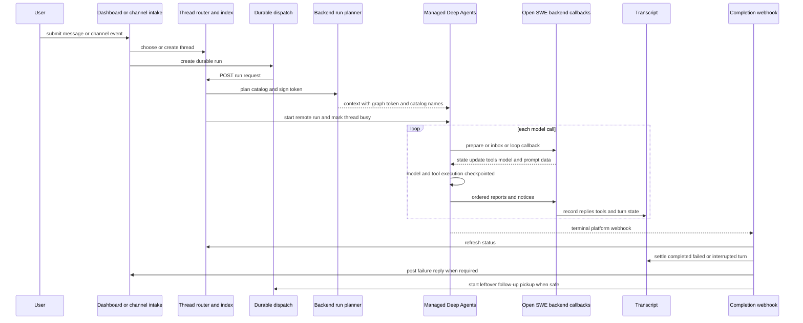

# From request to completed agent turn

An Open SWE turn crosses two ownership domains. The Open SWE backend owns request validation, thread metadata and index status, identity and credentials, the per-run catalog, inbox records, transcript projection, and completion handling. Managed Deep Agents (MDA) owns the remote graph execution: model loop, tools, sandbox-facing work, graph state, and checkpoints. The boundary is deliberately callback-oriented: the backend plans and signs a run before it starts; MDA calls the backend for credentialed operations and reports; the platform calls the backend when the run reaches a terminal status.

## End-to-end flow

This shows ownership and callback direction. The durable-run creation boundary is before MDA starts; callback and report delivery may retry independently; terminal reconciliation is best-effort and has a status-reconcile fallback.

## Intake, thread selection, and the visible request

### Dashboard requests

A dashboard session first resolves workspace and repository access, validates the selected model and optional image input, and creates a thread with immutable ownership and visibility metadata. When PostgreSQL is configured, it stamps the thread as transcript-backed and appends `ThreadCreated`; otherwise the UI falls back to LangGraph state. Starting a new dashboard thread dispatches the initial prompt after the thread exists.

For a dashboard `run.start` command, the backend reconstructs a structured user message rather than forwarding un-attributed text. It records a `TurnRequested` event before starting the run, keyed by the user message id so a retry joins the already-recorded turn rather than creating a duplicate. It also updates thread metadata, resolves model overrides, carries the transcript turn id in run configuration, and uses the dashboard stream modes. Image inputs are constrained to supported MIME types, at most five images, and 10 MiB each; a text-only model rejects image input.

### Channel requests and canonical input

Every non-dashboard trigger ultimately uses `dispatch_agent_run`. When a caller does not provide a prebuilt input, dispatch derives a `RunInput` from the source and configuration: it identifies Slack, GitHub, Linear, or a system sender; resolves a canonical person id; records channel context when available; and serializes the authored content in an `<input-message>` envelope. The envelope declares sender, surface, kind, optional channel, and structured data. Separate dynamic-context messages introduce people, channels, and systems, enabling the model to attribute subsequent messages without injecting the same context repeatedly.

This preserves an important separation: message provenance belongs to the input envelope, while attribution and authority belong to run metadata. Dispatch removes caller-controlled attribution fields, resolves `user_id` itself, and grants the acting-user field only to a run initiated by that person or to a channel's verified conversation run. A backend-triggered wake-up can be attributed to a person without acting as that person.

### Thread routing and remote startup

`ThreadRouter` makes the platform's normal `/threads` and `/runs` API look continuous while using a PostgreSQL index as the authoritative thread directory. New ordinary threads are indexed as `mda`, copied locally for compatibility, and created on MDA. Thread state, history, runs, commands, and streams route to the thread runtime. Local legacy threads are read-only for new runs. The router marks a thread busy only after MDA accepts the run and guards against a stop that arrived during startup; the completion webhook and a separate reconcile path settle that status later.

A channel-owned thread is special: its metadata names the channel, and the channel creates the remote conversation. The backend indexes and displays it but restricts ordinary writes; runs, interrupts, and cancellation use MDA trusted-backend ingress with the channel context. Copying or scheduling a cron on such a thread is refused. This keeps a Slack, Linear, or GitHub conversation on its channel-owned thread rather than having the dashboard impersonate that conversation.

## Durable dispatch and interruption semantics

`create_durable_run` is the shared dispatch contract for agent and reviewer triggers. It ensures a titled owned thread when asked, normalizes configuration and metadata, stamps a fresh invocation id and start time, and creates the run with the v3 stream configuration and subgraph streaming. It uses asynchronous durability, so each step has a checkpoint write without synchronously blocking every model or tool step. Stream resumption is disabled for externally dispatched runs because the dashboard renders the persisted transcript rather than replaying the runtime event buffer.

The default `multitask_strategy` is **`interrupt`**. A newly submitted interactive follow-up stops the active run and starts a replacement on the same thread; the previous run's checkpoints preserve progress, and the replacement sees thread history plus the new message. An `interrupted` terminal status is therefore not treated as a user-visible failure. This is distinct from **`enqueue`**, used for background work such as sandbox tool-result continuation or other work that must wait rather than displace the active turn. The `reject` strategy is used for a completion-time pickup attempt so it cannot disturb a run that started concurrently.

The completion webhook is attached only if both a shared secret and a non-loopback absolute completion URL are configured. This prevents an invalid webhook from preventing run creation, but means failure-reply completion behavior is unavailable without that configuration.

## Plan once, authenticate callbacks, build the remote graph

Before MDA runs a turn, `start_remote_run` validates that the selected hosted graph is supported, constructs a `RemoteRun` from the thread id, assistant id, configuration, and metadata, and asks the hosted graph to plan the run. Planning produces a catalog: granted operations and tool specifications, subagents, models, sandbox and file checks, skills, inbox behavior, loop rules, and trace metadata. The backend signs the resulting settings into a run token. MDA receives only the graph name, signed token, and a names-only catalog in remote context; its later calls present the token rather than fetching mutable caller configuration.

MDA's graph factory is shared per graph/model inputs, not per user or thread. Per-run behavior comes from the active run context and catalog: the run toolsets, model selection, skills, sandbox, prompt middleware, reporting middleware, and loop rules are read for the current run. The same mechanism also builds the `general-purpose` async worker graph; workers are separate Open SWE threads with their own token and report back through the backend-managed task lifecycle.

## The MDA loop, tools, and callbacks

`BackendRunMiddleware` is the bridge around MDA's graph. At run preparation it binds an MDA-created sandbox where applicable, accepts event/task items carried as the run's input, executes backend preparation hooks, and begins git evidence collection. Before each model call it reads the inbox, then either follows catalog-defined MDA loop rules or uses a legacy backend phase path.

For the normal catalog loop, MDA:

1. stops if the held state says the run should end or a client tool remains pending;
2. obtains task context and refreshes a due GitHub proxy in parallel;
3. restores run guidance hidden by summarization, obtains route/model choice when needed, and supplies the cached system, workspace, and thread prompt parts plus the allowed tool list;
4. executes model and tool steps in MDA, checkpointing graph state; and
5. after a tool-free answer, nudges for a required CLI result or Slack reply. If Slack reply nudges are exhausted, it can invoke the backend's `reply_on_behalf` callback using the last model text.

Tool execution is not proxied wholesale to the backend. MDA owns its file, shell, sandbox, browser, and agent-loop execution, while operations needing backend credentials or policy invoke typed backend endpoints. The catalog limits what is offered, includes file and shell guards, and grants each remote operation. MDA reports replies, tool starts/results, inbox receipts, and end notices so the backend can project them into the transcript and usage records. Subagent reports retain their task namespace, allowing the UI and transcript to distinguish them from the parent turn.

## Inbox follow-ups versus a new run

The thread inbox is deliberately pull-based. Before each model call, `ThreadInbox.read` takes a snapshot of items owed to the thread: queued human/background follow-ups, task messages, and subscribed event matches. It formats follow-ups as structured input messages, handles dashboard handoff from Slack to web, and supports image fetching only when the resolved model can read images.

Reading does **not** remove an item. The backend removes queued messages and marks task/event items received only after MDA sends the corresponding inbox receipt and the next model call goes ahead. If the run ends before that acknowledgement, the item remains owed to the next run. A run started specifically to deliver task or event items receives those ids during preparation, preventing redelivery.

A follow-up that arrives while a run is active is therefore not necessarily a new queued run: the active MDA loop can see it at its next inbox read. If it arrives after the last model call, it remains in storage. On a successful non-pickup completion, the backend checks for such leftovers and starts an empty-input pickup run. That pickup uses `reject`, so an already pending concurrent run wins and drains the same inbox. A failed run and a pickup run do not recursively start another pickup, avoiding an identical failing loop.

## Reliable reports, transcript updates, and recovery

MDA's `Outbox` provides the delivery boundary between remote execution and backend-visible UI state. It batches reply reports, tool-start/tool-result reports, inbox receipts, and one-way notices in creation order. Each report has a thread-unique key; the backend records a keyed report once even if MDA retries it. The outbox only removes an item when the backend explicitly returns it as taken. It retries delivery with backoff, can abandon immediate sending after a long outage, and carries still-unacknowledged items in the checkpointed `open_swe_outbox` state.

That checkpoint coupling is the core recovery invariant: work from a checkpointed graph step is sent again under the same idempotency key after process restart or by the next run on the thread; work from a non-checkpointed step is rerun. The outbox serializes ordinary tool results by reference to their checkpointed tool message when possible, avoiding duplication of large result payloads. It drains reports before phases that depend on them and queues `run_ended` after preceding replies, tool activity, and end-of-run work. Consequently, the backend normally sees transcript activity before it closes the turn.

The backend's transcript engine is the user-visible projection. Dashboard request handling writes requested and queued turn events, while report callbacks write reply/tool activity and middleware end handling settles the turn. The completion handler also calls `settle_run_turn`; its command id is intentionally the same logical settlement, so it safely fills gaps if MDA-side middleware did not, rather than creating a second terminal event.

## Completion, failures, and operations

The platform posts terminal run payloads to `/webhooks/run-complete`. The handler verifies the shared token at the route boundary, refreshes thread status, finalizes invocation usage telemetry when possible, settles the transcript as `completed`, `failed`, or `interrupted`, and records worker completion. Status refresh failure is non-fatal because reconciliation can correct it later.

On success, it may schedule Slack session-cost enrichment and delivers pending task messages and event subscriptions. On success of a normal run it also attempts the follow-up pickup described above. On `error` or `timeout`, it logs the failure and makes a best-effort source-specific notification to Slack, Linear, or GitHub. Failure notification is deduplicated per run through both metadata and an expiring event claim; repeated event-woken failures are capped. `interrupted` is explicitly excluded from this failure behavior because it is expected when an interactive replacement run interrupts a prior one.

Operationally, investigate a stuck turn across three layers: the index status and reconcile job, MDA run/checkpoint state, and backend transcript/report receipts. A missing completion webhook does not erase MDA checkpoint recovery but delays status and user-facing failure reconciliation. A report outage does not erase checkpointed reports; it leaves them in `open_swe_outbox` for retry or takeover. A queued message is safe to retry only until its receipt is acknowledged—after that, transcript and report idempotency, not duplicate delivery, define the recovery boundary.

## Focused verification

The repository tests exercise the contracts that make this workflow safe:

- `tests/agent/test_dispatch.py` asserts durable defaults: async durability, interrupt strategy, completion webhook, v3 stream modes, subgraph streaming, invocation metadata, and controlled acting-user attribution.
- `mda/tests/test_loop.py` checks that end-of-run work and `run_ended` are reported in order and retries do not make a failed report block following notices.
- `mda/tests/test_backend_calls.py` simulates a report outage, then verifies that checkpointed outbox entries are sent first with the same keys by a later run and are cleared only once acknowledged.
- Inbox behavior is implemented so snapshot reads alone do not consume items; only receipt processing does, which is the behavior to preserve when adding a follow-up source or an inbox item type.
